# geo-eval-gate — satellite change detection where an AI may label a change but cannot approve one

**Status: v0.2, portfolio project.** The deterministic screen, the evaluator gate, a real-data loader and scoring, and a local vision-model runner are built and tested, and the design has now been evaluated on **real Sentinel-2 imagery with human labels** (OSCD, 24 city pairs) under a protocol fixed in advance. The result is mixed and reported in full in [Results](#results): the gate reliably raises precision with one model, a second model added nothing, the models' self-reported confidence is not usable, and the screen is the main limit.

```text
$ python examples/demo.py
injected: 2 buildings, 1 cloud, global autumn decline
deterministic screen: 2 candidate boxes (cloud masked, season ignored)
  box x78-94 y25-42  area 268px  dNDVI 0.62
  box x58-74 y89-103  area 220px  dNDVI 0.63

evaluator gate on the first candidate, with different (untrusted) model replies:
  building  -> ACCEPT
  unsure    -> REJECT_LOW_CONFIDENCE  0.55 < 0.80
  season    -> REJECT_NOT_ACTIONABLE
  not json  -> REJECT_SCHEMA          Expecting value: line 1 column 1 (char 0)
  bad enum  -> REJECT_SCHEMA          1 validation error for ChangeVerificationResult
```

*Real output of [examples/demo.py](examples/demo.py). The scene is synthetic, and the "model replies" are hand-written strings standing in for a vision-language model, to show how the gate treats each kind of answer. They are not model outputs.*

## What is this? (plain-language overview)

Comparing two satellite photos of the same place taken months apart sounds easy: subtract one from the other. In practice a raw difference lights up everywhere. Crops turn brown in autumn, clouds drift across, the sun is at a different angle, and a few new roofs and a bulldozed field are buried in the noise. Sending every changed patch to an AI that looks at pictures would be slow and costly, and it would make confident mistakes, such as calling a cloud a building.

geo-eval-gate does it in two stages, and keeps the decision away from the AI:

1. **A cheap, fixed screen** takes the two images, checks they line up, measures how much the *vegetation index* (NDVI) and the *structure* (SSIM) changed at each pixel, masks out clouds, cleans up the result and proposes a handful of **candidate boxes**. Seasonal colour shifts are ignored because they change the colour but not the structure.
2. **A vision-language model may then label each candidate** from a fixed list: earthworks, new structure, road expansion, seasonal defoliation, or cloud artifact. But the model's reply is treated as untrusted text. It must be valid JSON in an exact format, its confidence must clear a floor, and its label must be one that counts as a real, actionable change. Otherwise the candidate is rejected, with the reason recorded.

**What it is not.** It is not a finished remote-sensing product. It does not download imagery, run a segmentation model, or contain a real VLM runner yet. It is the screening and gating core, tested on synthetic scenes.

### Who it is for, and when it earns its place

| If you are... | the project gives you... |
| --- | --- |
| building change detection on satellite or aerial imagery | a screening stage that cuts the number of patches an expensive model has to look at |
| putting a VLM or other model into an analysis pipeline | a pattern for accepting its output only through a schema, a confidence floor and an actionability rule |
| an analyst who needs to trust automated alerts | a decision with a recorded reason, not an unexplained model verdict |
| evaluating VLMs on imagery | a harness where the model's answers can be scored against injected, known changes |

It is a poor fit if you need pixel-accurate segmentation, near-real-time processing, or results validated on real imagery today.

### Why a screen first, and why a gate after?

A vision-language model on every tile of a large raster is too slow and expensive, so a cheap deterministic stage narrows the field. A model's confidence is not a probability you can trust by default, so it is not allowed to approve a change by itself: a schema, a floor and a class rule decide, in plain code.

**What's real and what's not.** The screening maths, the gate, the loader and the scoring are real, runnable and tested. The examples at the top use synthetic scenes and a scripted stand-in for the model. Separately, the design was run on **real imagery**: 24 Sentinel-2 city pairs from OSCD, two local vision-language models (Gemma 4 12B and Qwen2.5-VL 7B), a protocol written before any result was seen, and a test split run once. Those results are narrow (10 test pairs, urban-change labels only, 10 m pixels, one prompt) and their limits are stated in [docs/RESULTS_REAL.md](docs/RESULTS_REAL.md).

## At a glance

| | |
| --- | --- |
| Input | two co-registered GeoTIFFs (red, green, blue, near-infrared bands) |
| Screen | NDVI delta + SSIM delta, cloud mask, morphology, minimum area, candidate boxes and crops |
| Label | any model that returns text, behind a `VLMRunner` interface; a local Ollama vision runner is included |
| Gate | strict schema, confidence floor (default 0.8), actionable classes only |
| Measured (synthetic) | building recall 0.975 with the cloud mask, 0 false candidates per scene; about 4.5 ms per 128x128 scene |
| Measured (real, OSCD test split) | Gemma gate precision 0.67 against 0.42 for the screen alone (design screen), keeping about 70% of real candidates; the screens find about 39% of labelled objects |
| Tests | 41, including property-based and fake-server tests; `mypy --strict`; ruff |

## Architecture at a glance

```mermaid
flowchart LR
    IN[/"two GeoTIFFs<br>t0 and t1"/]
    subgraph screen["1 · Deterministic screen"]
        direction TB
        REG["co-registration check<br>CRS, transform, shape"]
        IDX["NDVI delta + SSIM delta"]
        CLD["cloud mask<br>bright + flat pixels,<br>dilated past the SSIM window"]
        MORPH["morphology + min area<br>to candidate boxes + crops"]
        REG --> IDX --> CLD --> MORPH
    end
    subgraph vlm["2 · Label (probabilistic)"]
        VLM["Vision-language model<br>untrusted text"]
    end
    subgraph gate["3 · Evaluator gate (deterministic)"]
        direction TB
        S{"valid JSON,<br>enum class,<br>confidence in 0-1?"}
        C{"confidence ≥ floor?"}
        A{"class actionable?"}
    end
    OK(["ACCEPT<br>EARTHWORKS · NEW_STRUCTURE<br>ROAD_EXPANSION"])
    R1(["REJECT_SCHEMA"])
    R2(["REJECT_LOW_CONFIDENCE"])
    R3(["REJECT_NOT_ACTIONABLE<br>SEASONAL_DEFOLIATION<br>CLOUD_ARTIFACT"])
    IN --> REG
    MORPH --> VLM --> S
    S -- "yes" --> C
    S -- "no" --> R1
    C -- "yes" --> A
    C -- "no" --> R2
    A -- "yes" --> OK
    A -- "no" --> R3
    classDef det fill:#e8f1fb,stroke:#2f6db5,color:#102a43
    classDef prob fill:#fff1d6,stroke:#c27c0e,color:#3d2500,stroke-width:3px
    classDef bad fill:#fde8e8,stroke:#c0392b,color:#4a1010
    classDef ok fill:#e3f5e8,stroke:#2e8b57,color:#0f3b21
    classDef io fill:#f2f2f2,stroke:#666,color:#222
    class REG,IDX,CLD,MORPH,S,C,A det
    class VLM prob
    class R1,R2,R3 bad
    class OK ok
    class IN io
    style screen fill:#f4f8fd,stroke:#2f6db5,color:#102a43
    style vlm fill:#fff9ec,stroke:#c27c0e,color:#3d2500
    style gate fill:#f4f8fd,stroke:#2f6db5,color:#102a43
```



*Blue is deterministic code; the amber box is the only probabilistic step, and nothing it says is accepted without passing the three checks after it.*

## Quickstart

```bash
git clone https://github.com/PCSchmidt/geo-eval-gate && cd geo-eval-gate
uv venv && uv pip install -e ".[dev]"            # add ".[geo]" for GeoTIFF loading (rasterio)

python examples/demo.py                         # the output shown above
python scripts/benchmark.py 100                 # synthetic screening benchmark
pytest -q                                       # 41 passed
```

```python
from geo_eval_gate import screen, crop, evaluate
from geo_eval_gate.io import load_pair            # needs the [geo] extra

t0, t1 = load_pair("2024-06.tif", "2025-06.tif")  # bands: red, green, blue, nir
for cand in screen(t0, t1):
    outcome = evaluate(my_vlm_runner, crop(t0, cand), crop(t1, cand))
```

A runner is any object with `classify(before_rgb, after_rgb) -> str` returning the model's raw text. `ScriptedVLM` is a test double, not a model.

## Approach: why it is built this way

- **Screen cheaply, judge sparingly.** Deterministic maths narrows a whole raster to a few boxes before any model runs.
- **The model proposes; plain code disposes.** Schema, confidence floor and class rule are ordinary code with tests; a model can never approve a change on its own say-so.
- **Reject for stated reasons.** Every outcome is one of four named decisions, so a rejected candidate explains itself.
- **Don't trust a mask you haven't tested.** The cloud mask, and the bug that its halo originally leaked false candidates, are covered by tests.
- **Synthetic first, honestly labelled.** Known injected changes make recall and false-candidate rates measurable before real data is involved, and the results say they are synthetic.

## Motivation

Remote-sensing change detection is a natural place for the pattern in my other projects: a fast, cheap deterministic stage, a probabilistic stage that is allowed to be wrong, and a gate that decides. The roadmap goal was a pipeline that could sit in front of an analyst and cut false alarms from clouds and seasons without letting a model's confidence stand in for evidence.

## Method (what the pipeline actually does)

1. **Load and check** (`io.py`): read the bands as reflectance; refuse a pair whose CRS, transform or shape differ.
2. **Index maps** (`screening.py`): NDVI = (NIR - red) / (NIR + red); SSIM computed on NIR + red with a 7-pixel mean window. A pixel is a change candidate if its absolute NDVI change exceeds 0.25 **or** its SSIM delta exceeds 0.5.
3. **Cloud mask**: pixels that are bright (mean above 0.75) and nearly flat across red, green and blue, dilated by 6 pixels so the SSIM window's halo around a cloud is also excluded.
4. **Clean and box**: binary opening then closing, connected components, and a minimum area of 25 pixels; each region becomes a box with its mean NDVI and SSIM change, sorted by size.
5. **Crop** each box with padding for the labelling model.
6. **Gate** (`gate.py`): parse the model reply as JSON against `ChangeVerificationResult` (confidence 0-1, one of five classes, rationale of 10-600 characters, no extra keys); reject below the confidence floor; reject classes that are not actionable.

## Results

### Real imagery (OSCD, Sentinel-2): the main evidence

Protocol: [docs/PROTOCOL.md](docs/PROTOCOL.md), written and pushed **before** any result was seen. 14 pairs for development (all tuning), 10 for the test split, run once. Labels cover urban change only (new buildings and roads), so precision is pessimistic. Full tables, intervals and caveats: [docs/RESULTS_REAL.md](docs/RESULTS_REAL.md).

**The screen** (all 10 test pairs): pixel F1 0.333 for the NDVI-or-SSIM design and 0.348 for a plain RGB-difference baseline; **both find only about 39% of the 668 labelled change objects**. On development data the design (F1 0.227) was *worse* than SSIM alone (0.260) and the RGB baseline (0.297): adding NDVI added vegetation false positives. The cloud mask made no difference on this data.

**The gate** (400 sampled test candidates per screen, thresholds frozen on development data):

| Model | Screen | Precision (screen alone to gate) | Recall kept | Precision lift, pair-level 95% interval | Verdict |
| --- | --- | --- | --- | --- | --- |
| Gemma 4 12B | NDVI or SSIM | 0.42 to 0.67 | 70% | **+0.24 [+0.09, +0.33]** | helps |
| Gemma 4 12B | RGB difference | 0.35 to 0.52 | 67% | **+0.18 [+0.05, +0.26]** | helps |
| Qwen2.5-VL 7B | NDVI or SSIM | 0.42 to 0.43 | 99% | +0.00 [-0.01, +0.01] | adds nothing |
| Qwen2.5-VL 7B | RGB difference | 0.35 to 0.36 | 98% | +0.01 [+0.00, +0.03] | adds nothing |

**Against the failure criteria stated in advance:**
- *Does the gate beat the screen alone on F1?* Gemma's point estimates say yes (+0.09, +0.08) but the 10-pair intervals include zero, so it is **not established**; Qwen no.
- *Does the VLM beat a three-number statistics classifier?* Gemma's point estimates are ahead (AUROC 0.73 against 0.66 on the design screen, F1 0.68 against 0.56 at the same number accepted) but the intervals include zero, so **not established**; Qwen is worse than the statistics.
- *Is the models' confidence calibrated (ECE at most 0.2)?* **No**: 0.29-0.47. Gemma reports only 0.90, 0.95 or 1.00, so every confidence floor up to 0.95 gives the same gate; the class label does the work and the confidence none.

So the honest reading is: the screen-then-gate design does what it claims on precision when the model is good enough (Gemma) and does nothing when it is not (Qwen); the confidence floor, as built, is not a usable control; and recall is bounded by the screen, not the gate.

### Synthetic scenes

Synthetic scenes only (`geo_eval_gate.synthetic.make_pair`: 128x128, seeds 1000-1099, two buildings, one cloud and a global seasonal vegetation decline per pair). This measures the deterministic screen, not any model. Reproduce: `python scripts/benchmark.py 100`.

| Config | Building recall | False candidates / scene | Candidates / scene | ms / scene |
| --- | --- | --- | --- | --- |
| NDVI + SSIM, cloud mask on | 0.975 | 0.00 | 1.77 | 4.5 |
| NDVI + SSIM, cloud mask off | 1.000 | 0.61 | 2.42 | 4.2 |

On synthetic scenes the cloud mask removes all 0.61 false candidates per scene and costs 2.5 points of recall, and a seasonal decline alone produces no candidates. **These are idealised**: real scenes, where the same design reaches pixel F1 0.33, behave very differently. Full synthetic tables: [docs/RESULTS.md](docs/RESULTS.md).

## Limitations

- **10 test pairs.** Every real-data conclusion carries wide intervals; most differences of a few points cannot be told from noise, and several of the headline comparisons are "not established" for that reason.
- **Labels are urban change only**, and a candidate counts as real if at least 30% of it overlaps a labelled change. Unlabelled change counts against precision.
- **The screen finds about 39% of labelled objects** (design and RGB baseline alike). The gate cannot recover what never became a candidate.
- **The NDVI-or-SSIM design did not beat a plain RGB difference** on development data and was on par on test; the NDVI part mostly adds vegetation false positives.
- **Confidence is not usable as a control.** Both models' self-reported confidence fails the calibration criterion, so a floor on it is not meaningful.
- **One prompt, two models, greedy decoding, 10 m pixels.** Qwen's failure may be a prompt effect (no prompt search was done, on purpose). Gemma was run with its reasoning phase off; behaviour with reasoning on was not tested.
- **Gate figures use a seeded sample of 400 candidates** per screen, not all of them.
- **Sentinel-2 at 10 m is coarse for buildings.** The vision model is working at the edge of what the pixels show.
- **Not done:** SAM 2 or Prithvi segmentation, imagery download pipelines (NAIP, Planetary Computer), a calibrated judge, other sensors or cities, an end-to-end recall measurement.

## Operational notes

### What runs where

Everything is local and CPU-only today; the screen processes a 128x128 synthetic scene in about 4.5 ms. A real VLM runner (not included) would need a GPU or a hosted endpoint, and the gate does not care which.

### Data and keys

No keys and no downloads. The benchmark data is generated from a seed. Any real imagery used later should be public or unclassified (Sentinel-2, NAIP).

### Verify the claims (a reviewer's path)

```bash
pytest -q                          # 41 passed
mypy src tests scripts             # strict, clean
python examples/demo.py            # the screen and gate decisions shown at the top
python scripts/benchmark.py 100    # the table above
docker build -t geo-eval-gate . && docker run --rm --network none geo-eval-gate
```

### Documentation map

| Doc | What it covers |
| --- | --- |
| [docs/RESULTS_REAL.md](docs/RESULTS_REAL.md) | the real-data (OSCD) results, intervals, calibration, failure criteria, what went wrong |
| [docs/PROTOCOL.md](docs/PROTOCOL.md) | the evaluation plan written before any result was seen, and every deviation from it |
| [docs/RESULTS.md](docs/RESULTS.md) | the synthetic benchmark, how to read it, what is not measured |
| [results/real/](results/real/) | frozen settings, per-candidate model replies and all result JSON |
| [examples/demo.py](examples/demo.py) | the worked example above |
| [scripts/benchmark.py](scripts/benchmark.py) | the benchmark |
| [src/geo_eval_gate/gate.py](src/geo_eval_gate/gate.py) | the evaluator gate |

## License

MIT. See [LICENSE](LICENSE).

## Author

Chris Schmidt ([PCSchmidt](https://github.com/PCSchmidt)). Part of a portfolio on evaluator-gated AI systems: probabilistic components propose, deterministic gates decide.
