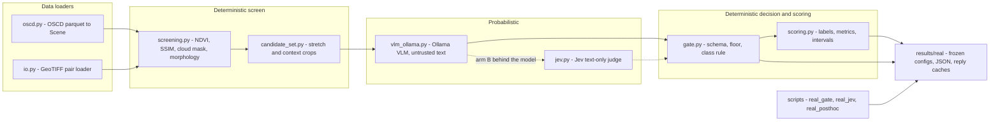
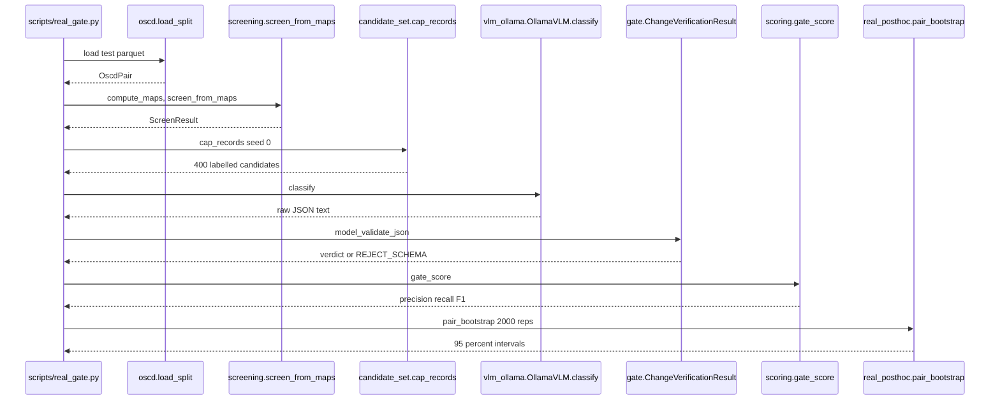

# geo-eval-gate — Master Explainer

Repo: <https://github.com/PCSchmidt/geo-eval-gate> (public) · Live demo: none (CLI/library study) · License: MIT, "Copyright (c) 2026 PCSchmidt" · Last commit: 2026-10-13 (`66ff02c`); tag `v0.2.0`; release v0.2.0 on GitHub
Status: v0.2 portfolio research study · active burst 2026-10-09 → 2026-10-13 (16 commits) · "paused or done" [Unknown]
Explainer generated: 2026-10-18 by an AI agent under Chris Schmidt's direction · Questionnaire v1.2 · Depth: LITE (LITE run)

> **Assembly note.** Assembled from this run's earlier section-9 pass (`geo-eval-gate.math.md`, reproduced as §9) plus a fresh read-only inspection of the clone and one GitHub API check (2026-10-18). The VERA pass files do not apply to this repo; every non-§9 section is new this session.
>
> Tags: **[Verified]** seen in code/config/tests/commits (cited `path:line`/function/SHA); **[Documented]** committed doc (cited); **[Author]** `AUTHOR_CONTEXT.md` ANSWER line (2026-10-18); **[Inferred]** reasoned; **[Proposed]** not in repo; **[Unknown]** → §26. **No execution this run**: nothing is [Measured]; repo-stated numbers are "the repo reports" [Documented]. One fact, one home (CL-…, W-…, D-…, §n).

## TL;DR

**V.1** geo-eval-gate asks whether a vision model may approve a change on satellite imagery, and answers it architecturally: a cheap deterministic screen (NDVI + SSIM change, cloud mask, morphology) proposes candidate boxes, a vision-language model may only *propose* a label, and a plain-code gate decides on schema validity, a confidence floor and an actionable-class rule — then the whole design is measured on real OSCD Sentinel-2 pairs under a protocol committed before any result was seen. [Verified] `src/geo_eval_gate/screening.py`, `gate.py`; [Documented] `docs/PROTOCOL.md`

**V.2** The result is mixed and published in full: with Gemma 4 12B the gate raised candidate precision ~+0.24 (pair-level 95% interval excludes zero) keeping ~70% of real candidates; Qwen2.5-VL 7B added nothing; both models' confidence failed the pre-registered calibration bar (ECE 0.29–0.47 vs ≤ 0.2), so the floor — the design's central control — proved unusable; and the screen (~39% of labelled objects found) is the binding limit. A follow-up calibrated text judge (Jev) turned out to be a calibration layer, not a better judge. [Documented] `docs/RESULTS_REAL.md`, `docs/RESULTS_JEV.md`

## Repository fact sheet

| Field | Value | Tag / source |
| --- | --- | --- |
| Name · URL · license | geo-eval-gate · github.com/PCSchmidt/geo-eval-gate (public, 0 stars, 2 open items = Dependabot PRs) · MIT | [Verified] GitHub API 2026-10-18, `LICENSE` |
| One-line description (from code) | deterministic NDVI/SSIM screen → VLM label proposal → schema + confidence + class gate → OSCD-scored with bootstrap/AUROC/ECE | [Verified] `src/geo_eval_gate/` |
| Category / flags | research study + library + eval harness · `[DATA]` `[MATH]` `[AI]` `[RESEARCH]`; consumes service APIs (Ollama, TypeSafe) but exposes no service · no `[UI]`, no `[AGENT]`, no `[FORK]` | [Inferred] |
| Size | 70 tracked files; 25 .py ≈ 2,470 lines (src ≈ 1,150 · tests ≈ 565 · scripts ≈ 650); 6 .md ≈ 630; 12 result .json ≈ 2,420; 16 reply-cache .jsonl ≈ 6,400 | [Verified] `git ls-files` |
| History | 16 commits, 2026-10-09 (`94f36b7`) → 2026-10-13 (`66ff02c`); one branch `main` (+2 remote Dependabot branches); tag `v0.2.0`; all commits authored/committed "Chris Schmidt", every body carries `Co-Authored-By: Claude Sonnet 5.5` | [Verified] `git log` |
| Entry points | `examples/demo.py`; `scripts/{benchmark,real_dev_screen,real_gate,real_jev,real_posthoc,real_jev_posthoc,probe_vlm}.py`; drivers `run_dev_gate.sh`, `run_test_gate.sh`, `fetch_oscd.sh`, `pull_vlm.sh` | [Verified] |
| Runs from clean clone? | [Unknown] — not run this session (no execution); README quickstart gives `uv venv && uv pip install -e ".[dev]"` then `python examples/demo.py` | [Documented] `README.md` |
| Tests pass? | [Unknown] — not run; static count: 42 test functions collecting to **54 cases** (two parametrized sets: 10 and 4 cases), matching the repo's "54 passed" claim | [Verified] static count; [Documented] `README.md` |
| CI | single `ci` job on push/PR: Python 3.12, `pip install -e ".[dev]"`, `mypy src tests`, `pytest -q`; latest run on `66ff02c` **success** 2026-10-13; Dependabot PR run also green | [Verified] `.github/workflows/ci.yml`; GitHub API 2026-10-18 |
| Live demo / screenshots | none; `examples/demo.py` prints a synthetic worked example quoted in the README | [Verified] repo has no demo assets |
| External services / paid APIs | local Ollama (127.0.0.1:11434, models gemma4:12b, qwen2.5vl:7b); TypeSafe Jev API (optional, $0.042/M input tokens, key `TYPESAFE_AI_API_KEY`); Hugging Face dataset download | [Verified] `vlm_ollama.py:52`, `jev.py:17-19`, `scripts/fetch_oscd.sh` |
| AI coding tools evidenced | commit trailers: `Claude Sonnet 5.5` on all 16 commits; [Author] names Claude Code (main), GitHub Copilot, Codex, Prime-Agent — **conflict flagged**, see §17/§26 | [Verified] `git log`; [Author] Q3/Q4 |
| Related repos | "evaluator-gated roadmap studies" family (entity-resolution-gate, rag-audit, edge-slm-eval, …) sharing PROTOCOL/RESULTS discipline and the gate thesis | [Inferred] ⚠ grouping in `AUTHOR_CONTEXT.md` |
| Headline claims | 12 audited in §11 (CL-01…CL-12); 10 Supported/Partially, 1 stale-claim failure (CL-11), 1 Unverified | [Verified] §11 |
| What CI really runs | `mypy src tests` (not `scripts`) + `pytest -q`; no ruff step despite ruff being configured and claimed clean | [Verified] `ci.yml`, `pyproject.toml` |
| Scripts that write tracked files (not run here) | `real_dev_screen.py` → `frozen_screen.json`/`dev_screen.json`; `real_gate.py` → `frozen_gate.json`/`gate_test_*.json`/`gate/*.jsonl`; `real_jev.py` → `frozen_jev.json`/`jev_test_*.json`/`jev/*.jsonl`; `real_posthoc.py` → `posthoc_test.json` | [Verified] write call sites |
| Tests needing external resources | none: Jev/VLM tests use local fake HTTP servers; `test_no_secrets` skips outside git; Docker CMD runs `pytest -q` (`--network none` per README) | [Verified] test sources |

## 1. For everyone: what it does and why it matters (A)

**A.1 ★** A referee for AI image analysis: fixed maths finds real ground changes between two satellite photos; a vision model may only *suggest* what each change is; plain code decides if the suggestion passes. **A.2 ★** The problem: raw photo differences light up everywhere (autumn, clouds, sun angle), so reviewers drown in false alarms and unreviewed models confidently call clouds buildings; before it, people reviewed every tile by hand or trusted model verdicts. **A.3** A remote-sensing/defense analyst triaging change alerts gets a short list of gated candidates with recorded reasons instead of hundreds of raw patches. **A.4** [Skipped — no UI]. **A.5 ★** Analogy: a "spot the difference" puzzle printed on two different days — one copy faded, a smudge over a corner — where a friend names each candidate difference but you record it only if they fill in the proper form with a confidence and an acceptable category (§9 opens with this). **A.6** Most surprising: the honest negative — the gate's central confidence floor measures nothing (Gemma reports only 0.90/0.95/1.00), and the repo publishes that. [Documented] `docs/RESULTS_REAL.md` **A.7** Information: public OSCD Sentinel-2 pairs (24 cities, 2015–2018), fetched on demand; fixed, not live. **A.8** Wrongness is visible: every verdict is one of four named decisions with a reason, and every claim carries intervals; trust the recorded process, not the confidence number. **A.9** The AI only proposes one of five classes with a confidence and one-line rationale; it neither finds changes nor approves them. [Verified] `gate.py:56-75` **A.10 ★** Can't: segmentation, real-time use, non-urban change, recall past the screen's ~39% of labelled objects, calibrated probabilities. **A.11** Cost: cents — the Jev extension cost ~$0.06 total; the rest is local CPU/GPU. [Documented] `docs/RESULTS_JEV.md` **A.12** Data safety: public imagery only; one optional API key in git-ignored `.env`, guarded by a test; never imagery but derived numbers and model text go to the API. [Verified] `tests/test_no_secrets.py` **A.13** Built in ~five days (2026-10-09→13) by Chris Schmidt directing AI agents; per [Author] very little code is hand-written — he set scope, plan, goals, architecture. [Author] Q3 **A.14** Agents could scaffold this for anyone; the pre-registration, freezes and published negatives reflect the author's judgment. [Inferred] **A.15** Monetizable as an evaluation/gating service for VLM-in-imagery pipelines; missing: packaging, more sensors, a fitted calibrator. [Inferred] **A.16** If gone, readers lose a clean "checked before trusted" case study, including its own central control failing. [Inferred]

## 2. Purpose, problem, users and use cases (B)

**B.1 ★** Problem: satellite change detection drowns in nuisance change, and naive AI verification adds confident mistakes; who: analysts comparing image pairs, every review cycle. **B.2** Motivation: portfolio research question ("a natural place for the pattern in my other projects" — README) plus defense-sector interest [Author] Q6. **B.3** Brought: applied mathematics (Towson; JHU coursework) and program-work habits; learned: remote-sensing practice and local VLM serving. [Documented] `AUTHOR_CONTEXT.md`; [Inferred] **B.4** Assumptions: co-registered pairs; 10 m pixels suffice for a VLM ("at the edge of what the pixels show"); confidence could gate decisions (**failed**, ECE 0.29–0.47); NDVI+SSIM beats RGB difference (**failed on dev**). [Documented] `docs/RESULTS_REAL.md` **B.5** Demonstrates: pre-registered evaluation, gate architecture, honest negative reporting, typing/CI discipline. **B.6 ★ Requirements:** deterministic screen with fixed thresholds; gate with schema + floor + class rule; synthetic benchmark with injected truth; real-data protocol with frozen dev→test configs (all essential, documented); VLM runner behind `VLMRunner`; Jev extension (desirable, documented, measured negative); rasterio loader (optional); SAM 2/Prithvi, Florence-2, download clients (roadmap, **not built**). [Verified] **B.7** Non-functional: reproducibility (greedy, seed 0, seeded sampling), secret hygiene, `mypy --strict`, cheap runs ($1 caps in code). **B.8** Constraints: one Windows laptop, RTX A4500 16 GB (throttles; repo logs a 93 °C crash), local Ollama, cents-to-dollars spend, flaky DNS. [Documented] **B.9 ★ Changes:** seven self-logged deviations — second screen after dev results; `think:false` for Gemma; retry/cooling after GPU crash; no Qwen prompt change; floors recorded meaningless; pair-level bootstrap post-test; filename fix. [Documented] `docs/PROTOCOL.md` **B.10 Unmet:** segmentation, download clients, Florence-2, end-to-end recall, calibrated confidence. **B.11 ★ Users:** primary — the author/reviewer evaluating VLM gating; secondary — engineers wanting the pattern; edge — anyone reading "ACCEPT" as ground truth (must not). **B.12 ★** Use cases → §3. **B.13 ★ Journey:** scene pairs → screen boxes → contrast-stretched crops → VLM JSON text → ACCEPT/REJECT_* with reason → human-mask labels score it → frozen thresholds and intervals out. **B.14** Invalid input: shape mismatch raises `ValueError`; malformed text → `REJECT_SCHEMA` with first error line; missing Jev key → error naming the variable, never its value. [Verified] `scene.py:12-16`, `jev.py:56-62` **B.15** Automated: all computation; manual: human masks, threshold freezes, success criteria. **B.16** Unintended use: teaching artifact for pre-registration; warned: alerting at 10 m, non-urban claims. **B.17** Poorly served: non-urban change analysts, near-real-time users. **B.18 ★ Out of scope:** segmentation, imagery acquisition, real-time processing, prompt search (deliberate), multi-sensor fusion. [Documented] **B.19 ★ Measured today:** pixel P/R/F1, object recall, gate P/R/F1 at frozen floors, AUROC vs 3-feature baseline, ECE/Brier, pair-level 95% intervals, latency, schema-validity. Not measured: users, time saved, end-to-end recall (~25% is a suggestion, not a measurement). [Documented] **B.20** User failure: acting on an "ACCEPT" artifact, or trusting the floor as calibrated. **B.21 ★ Done-ness:** "v0.2 portfolio project" with known gaps; whether done [Unknown] (§26). **B.22** Shares the gate pattern and PROTOCOL/RESULTS discipline with entity-resolution-gate, rag-audit, edge-slm-eval; no shared code. [Inferred] **B.23** Defense fit: air-gap-friendly (local Ollama, imagery stays local) but real use needs accreditation, SBOM, pinned deps, audited endpoints. [Inferred]

## 3. Capabilities inventory (B.12, J.1)

| Capability | State | Evidence |
| --- | --- | --- |
| deterministic NDVI/SSIM screen → candidate boxes | working | `screening.py`; [Documented] `docs/RESULTS.md` (synthetic), `docs/RESULTS_REAL.md` (OSCD) |
| evaluator gate (schema + confidence floor + actionable class) | working | `gate.py:56-75`; demo output [Documented] `README.md` |
| synthetic scene generator + benchmark (injected buildings/clouds/season) | working | `synthetic.py`, `scripts/benchmark.py`; [Documented] `docs/RESULTS.md` |
| OSCD loader, candidate labelling, pixel/object/gate scoring | working | `oscd.py`, `scoring.py`, `candidate_set.py` |
| local Ollama VLM runner with JSON-schema-constrained output | working (real runs on 2 models) | `vlm_ollama.py`; `results/real/gate/*.jsonl` |
| dev/test protocol with frozen screens and floors, one-shot test guard | working (process + code) | `real_gate.py:250-258`, `results/real/frozen_*.json` |
| pair-level bootstrap intervals + AUROC/ECE/Brier | working | `real_posthoc.py`, `scoring.py`, `real_jev.py:133` |
| statistics + stacked logistic baselines (sklearn) | working | `real_gate.py:203-218`, `real_jev.py:112-176` |
| TypeSafe Jev calibrated-judge extension (2 arms, budget-capped) | working; measured negative | `jev.py`, `real_jev.py`; [Documented] `docs/RESULTS_JEV.md` |
| GeoTIFF pair loading with co-registration check | working code, untested this run | `io.py` (optional `[geo]` extra) |
| SAM 2 / Prithvi segmentation candidates | **not built** (roadmap gap) | [Documented] `README.md` Known gaps |
| Florence-2 patch verifier | **not built** (roadmap gap) | [Documented] `README.md` Known gaps |
| imagery download clients (Sentinel Hub, Copernicus, NAIP, Planetary Computer) | **not built**; OSCD fetch script only | [Documented] `README.md`; `fetch_oscd.sh` |

## 4. Domain perspective (C)

**C.1 ★** Domain: optical remote-sensing change detection. Modelled: Sentinel-2 reflectance (red/green/blue/NIR), NDVI vegetation proxy, SSIM texture proxy, OSCD urban-change masks, candidates as connected pixel components; formulas standard, definitions per the OSCD card. [Verified] `oscd.py:10-18` **C.2** Follows Sentinel-2 band order (`oscd.py:28`); ignores STAC/COG, projections, atmospheric correction, land-cover taxonomies — raw pixel space only. **C.3** Simplifications that could mislead: no radiometric normalization beyond DN/10000; fixed thresholds define "change"; 30% overlap defines "real"; clouds masked by a bright-and-flat heuristic, not QA bands. [Verified] `screening.py:20-28`, `scoring.py:46` **C.4** Edge cases (shadows, snow, sun angle, misregistration) unmodelled; seasonal colour change handled by design and tested (`tests/test_geo.py:43`). **C.5** Missing: registration is checked not performed; no viewing geometry, orthorectification, per-pixel QA. **C.6 ★** Sources → §8. **C.7** OSCD is a published benchmark (Daudt et al., IGARSS 2018) but urban-only; 10 m is coarse for buildings. [Documented] **C.8** Provenance strong: raw reply + label per candidate, thresholds frozen in committed JSON, numbers derived by committed scripts. [Verified] **C.9** No staleness (fixed imagery); contradiction handled by intervals. **C.10 ★** Thresholds + morphology + gated verdict; an expert would accept the discipline, question resolution and the overlap rule. [Inferred] **C.11** Uncertainty: pair-level bootstrap + calibration error (ML practice, not estimative language). **C.12** Hallucination contained, not prevented (floor proven unusable); no citation verification. **C.13** Validated: SSIM/NDVI, morphology, bootstrap, AUROC/ECE; heuristic: cloud constants, 30% rule, context scaling. **C.14** Expert review: [Unknown] (§26). **C.15 ★** A professional would trust pipeline discipline for triage, not individual verdicts; needs finer imagery, calibrated probabilities, non-urban labels. [Inferred] **C.16** Slots ahead of an imagery analyst, replacing "review every raw tile". **C.17** Harm: false "ACCEPT" could feed an intelligence product; record + published miscalibration reduce, not remove, unwarranted confidence. **C.18** Legal: OSCD licence "listed as unknown" → no redistribution; TypeSafe MCA 2.3(b) forbids training on Jev output (respected). [Verified] `jev.py:12-13` **C.19** Trust eval: more cities/sensors, non-urban labels, end-to-end recall, expert review. **C.20** Skeptic first: "objects are 2–3 pixels and unlabelled change counts against you — what does 0.67 precision mean at 10 m?" Answer: pessimistic-biased and resolution-bound, as the docs say.

## 5. Codebase guide (D)

**D.1 ★** Tree: `src/geo_eval_gate/` (core: `screening.py`, `gate.py`, `scoring.py`, `scene.py`, `oscd.py`, `candidate_set.py`, `vlm_ollama.py`, `jev.py`, `synthetic.py`, `io.py`); `scripts/` (eval drivers + shell harnesses, core); `tests/` (6 files); `docs/` (PROTOCOL/RESULTS ×3, core evidence); `results/real/` (frozen configs + results + reply caches, generated-but-committed evidence); `examples/demo.py`. **D.2 ★** Entry points: `examples/demo.py`; `benchmark.py 100`; `real_dev_screen.py`; `run_dev_gate.sh`; `run_test_gate.sh`; `real_posthoc.py`; `real_jev.py probe|dev|test`; `real_jev_posthoc.py`. [Verified] **D.3 ★** Setup: `uv pip install -e ".[dev]"` (+`[geo]`, `[real]`), `fetch_oscd.sh`, `pull_vlm.sh`, `.env` key for Jev; clean-clone run [Unknown] this session. [Documented] **D.4** Config: `ScreeningConfig` defaults (`screening.py:56-63`) + `results/real/frozen_*.json`; deps `pyproject.toml`; CI `ci.yml`. **D.5** Read first: `gate.py`, `screening.py`, `scoring.py`, `docs/PROTOCOL.md`, `real_gate.py`; least obvious: frozen-JSON contracts, `stretch_pair` (shared stretch keeps brightness change visible). **D.6** Generated/vendored: none in `src/`; result artifacts committed on purpose. **D.7 ★** Key functions: `compute_maps`/`screen_from_maps`; `gate.evaluate`; `label_candidates`/`gate_score`/`bootstrap_ci`/`auroc`/`expected_calibration_error`; `real_gate.test`; `pair_bootstrap`; `OllamaVLM.classify`; `JevJudge.ask`. [Verified] **D.8 ★** `gate.evaluate` (`gate.py:56-75`): raw string in, one of four named decisions out, reason recorded. **D.9** Non-obvious: `ssim_map` variance as `E[x²]−E[x]²` via uniform filter (`screening.py:31-43`); `stretch_pair`'s shared percentile window (`candidate_set.py:23-33`). **D.10** Most fragile: frozen-file parsing (`real_gate.py:57-70`, `"off"`→∞) + one-shot guard (`:250-258`). **D.11** Functional core / imperative shell: `src/` pure, `scripts/` do I/O. [Verified] **D.12** Calls + dataclasses; scripts share state via JSON/JSONL. **D.13** Errors: `ValueError` refusals; parse/`ValidationError` → `REJECT_SCHEMA`; `JevError` never contains the key; bounded retries; stop-on-first-failure. **D.14 ★** Prompts: inline versioned strings — VLM system prompt (`vlm_ollama.py:23-30`), Jev `INSTRUCTION` (`real_jev.py:42-46`, "Frozen before the first call"); changes pre-registered. [Verified] **D.15** Typed frozen dataclasses, `mypy --strict`, ruff 100-col, docstrings state assumptions. **D.16** Debt: `maps_for`/`load_screen` duplicated in two scripts [Verified]; `[vlm]` extra (torch/transformers) unused by `src/` [Inferred]. **D.17 ★** README vs code: 3 discrepancies → §24 (worst: "What it is not"). **D.18** Highest complexity/value: `real_gate.py` (orchestration), `scoring.py` (metric definitions).

## 6. Tech stack and rationale (E)

**E.1 ★** Python 3.11+ (CI 3.12): array maths + eval harnessing is NumPy/SciPy/sklearn territory; a port would rewrite ndimage and pydantic for no gain. **E.2** No framework — the "framework" is `VLMRunner` + dataclasses. **E.3 ★** Load-bearing: `numpy`+`scipy.ndimage` (screening maths), `pydantic` (the gate schema = the enforcement mechanism), `scikit-learn` (baselines), `pyarrow`+`pillow` (OSCD decoding); removable: `matplotlib` (unused [Inferred]), `rasterio` (optional). [Verified] **E.4** Hand-written: SSIM, NDVI, bootstrap, ECE, AUROC; library: morphology, labelling, rankdata, logistic regression. **E.5** `>=` ranges, **no lockfile** (W-STACK-1); Dependabot monthly (2 open PRs); MIT-compatible licences. **E.6** Services: TypeSafe Jev (optional, one module), Hugging Face (data), Ollama (local); minimal lock-in. **E.7** uv/venv; `Dockerfile` → `pytest -q`, `--network none` per README; no hash pinning. **E.8** `mypy --strict` + pydantic plugin, ruff, pytest + hypothesis, GitHub Actions; author side Windows + RTX A4500 + Ollama. **E.9** Enterprise: IL endpoints or on-prem Ollama, pinned mirror, SBOM/STIGs, FedRAMP for hosted judges. [Inferred] **E.10** Debt: unpinned deps; unused torch/transformers extra. [Inferred]

## 7. Architecture: diagrams, execution walkthrough, ADR table (F)

**F.1 ★** Pure functional-core library + imperative eval scripts — a batch **pipeline** (screen → label → gate → score), not a service. **F.2 ★** In words: loaders produce co-registered `Scene` pairs; the screen boxes candidate changes; `candidate_set` makes stretched crops and labelled records; the probabilistic layer (Ollama VLM, optionally Jev behind it) returns untrusted text; the gate turns text into four-way decisions; scoring turns decisions + labels into metrics; scripts freeze configs, sample, cache, compute intervals; `results/real/` is the evidence store.

**F.3 ★ Trace — one test-split gate run** (`real_gate.py test --model gemma4:12b --variant design`): `main` (`real_gate.py:314-320`) → `test()` refuses without a frozen dev entry and if its output exists (`:252-258`) → `load_screen` (`:57-70`) → `split_candidates` streams parquet, screens via `compute_maps`/`screen_from_maps` (`:82-110`) → `cap_records(400, seed=0)` (`candidate_set.py:65-68`) → `run_vlm` → `OllamaVLM.classify` (256 px side-by-side PNG, temp 0, seed 0, `think:false`), replies cached (`:149-188`) → `accepted()` schema + class + floor (`:190-196`) → `at()` + `bootstrap_ci` (`:266-286`) → AUROC/ECE/stats (`:288-305`) → one JSON (`:307`). Post-test: `pair_bootstrap`, 10 pairs × 2,000 (`real_posthoc.py:28-44`). [Verified]

**F.4** Boundaries clean: pure `src/` vs `scripts/`, enforced by convention + `mypy --strict`. **F.5** Synchronous, sequential; VLM calls are the long pole, retry/cooling around them (`real_gate.py:112-147`). **F.6** Coupling: frozen-JSON schemas bind the three `real_*` scripts; all depend on `scoring.py`. **F.7 ★** State: files only — frozen configs (truth for thresholds), reply caches (resumability + provenance), result JSONs (claims). **F.8 ★ Contracts:** `ChangeVerificationResult` (`gate.py:25-30`: confidence ∈ [0,1], 5-enum, rationale 10–600, `extra="forbid"`); `VLMRunner` (`gate.py:48-53`); dataclasses; frozen-JSON schemas. **F.9** Patterns: generator–evaluator with **gate**; adapter; pipeline; seeded sampling; per-candidate idempotent cache. **F.10** New model = one `--model` flag; new screen = one `Variant` row (`real_dev_screen.py:42-46`). **F.11 ★ Invariants (attacked):** (1) co-registration enforced (`require_coregistered`); probe: a rotated band passes shape checks and corrupts silently [Inferred]; (2) no acceptance without schema — prose → `REJECT_SCHEMA` (`tests/test_geo.py:87-101`); (3) test runs once — probe: deleting the output defeats the guard (`real_gate.py:256-257`) [Inferred]; (4) frozen-before-test — files mutable; only commit order evidences it (J.12); (5) no tracked secrets — `test_no_secrets` scans all tracked files (`tests/test_no_secrets.py:19-22`). **F.12 ★ Commands:** §5 entry points; plain args, JSON/JSONL out, non-zero on contract violations, no auth (local CLI). **F.13** APIs: Ollama `/api/chat` (`format` schema, `keep_alive 20m`); TypeSafe `/v1/systemone` (bearer, retries on 5xx/429 + backoff `jev.py:95-113`); vendor versioning; budget caps in code. **F.14** Caches make stages resumable; drivers stop on first failure; retries capped (4+4). **F.15–F.18** [Skipped — no UI]. **F.19 ★ Scale:** 10× — screen cheap, VLM calls dominate; 100× — 400-cap and caching bind; 1000× — batch inference + sampling stats; first break: Ollama-on-one-laptop. [Inferred] **F.20** Ollama 500/timeout → retry + cooling then stop; Jev → bounded retries → `JevError`. **F.21** Rerun-safe via (pair, index) caches; test stage deliberately non-rerunnable. **F.22 ★ SPOF:** frozen JSON files + the single laptop GPU. **F.23** Leak: `real_posthoc` imports `real_gate` internals [Inferred]; essential complexity is the pre-registration machinery. **F.24 ★ Design decisions:**

| Decision | Optimized for | Sacrificed |
| --- | --- | --- |
| screen-then-gate two-stage | cost, auditability | recall (screen bounds all) |
| schema + floor + class rule in plain code | deterministic control | model vocabulary flexibility |
| 30% overlap labelling | reproducible labels | boundary sensitivity (W-MATH-1) |
| NDVI-or-SSIM pre-registered screen | hypothesis clarity | accuracy — lost to RGB on dev (Deviation 1) |
| frozen configs + one-shot test | honest generalization | rerun convenience; guard bypassable (W-ARCH-1) |
| pair-level bootstrap post-hoc | honest intervals | pre-registration purity (Deviation 6) |
| seeded 400-candidate cap | affordable VLM budget | sampling noise (W-MATH-5) |
| `think:false` for Gemma | valid JSON in 200 tokens | untested reasoning mode |
| local Ollama only | privacy, cost | one throttled GPU's throughput |
| committed reply caches | provenance, resumability | test labels visible later (W-EVAL-1) |

**F.25** Leverage: freezing thresholds before test; burden: the frozen-JSON contract; would reverse: the confidence floor (N.12). [Inferred] **F.26** Redesign: fitted calibrator instead of the floor, segmentation proposals; enterprise: service wrapper, pinned deps, IL endpoints, audit logs. [Proposed]

## 8. Data architecture (G)

**G.1 ★** In: OSCD parquet splits — per row two 13-band uint16 cubes (~20 MB) + PNG mask [Documented] `oscd.py:1-12`; transient: `Scene` arrays in [0,1], `ChangeMaps`, crops; stored: frozen configs, reply records, result JSONs (~9 k lines); out: metrics + per-candidate verdicts. Example: `Candidate(x0=58, y0=89, x1=74, y1=103, area_px=220, mean_abs_dndvi=0.63, …)` [Documented] `README.md`. **G.2 ★** Files only: parquet (git-ignored `data/oscd/`), JSON configs/results, JSONL reply caches; no DB at 400-row scale. **G.3 ★ Model:** `Scene` (`scene.py:9-16`); `ChangeMaps` (`screening.py:75-80`); `Candidate` (`screening.py:45-53`); `ScreenResult` (`screening.py:66-72`); `CandidateRecord` (`candidate_set.py:53-58`); `OscdPair` (`oscd.py:33-38`); `ChangeVerificationResult`/`GateOutcome` (`gate.py:25-44`); reply rows `{pair, index, positive, raw, latency_s, schema_ok, change_class, confidence}` (`real_gate.py:171-181`); Jev rows add `p_yes, input_tokens` (`real_jev.py:102-105`). **G.4** On-demand ETL: curl → parquet → band selection + DN/10000 → per-pair screening. **G.5** Validation: pydantic on model text; shape checks; `require_coregistered`; unchecked: reflectance sanity, mask alignment, NaNs beyond `clip`. [Verified] **G.6** Missing/duplicate/conflict unhandled; shape mismatch raises. **G.7** Provenance: verbatim replies with labels/latency; frozen configs committed; results cite scripts. **G.8** Only index: the (pair, index) reply cache; permanent, never invalidated. **G.9** Truncated JSONL breaks resume; one-shot guard doubles as tripwire. [Inferred] **G.10** Git is the backup; no migrations — script/frozen-file schema drift is the risk (W-ARCH-1). **G.11** No sensitive data; the Jev key never enters data files. [Verified] **G.12** Distortions: urban-only labels (precision pessimistic), test pairs richer in change than dev (cross-split comparison invalid), 10 m pixels. [Documented] **G.13** Alternative: DuckDB/SQLite over reply caches — better only at 10⁵+ candidates. [Proposed]

## 9. Algorithms and mathematics (H)

The mathematical machinery in geo-eval-gate answers two questions in order: **which small patches of ground really changed between two satellite photos of the same city, and may a model's opinion about one of those patches be trusted?** A raw photo difference lights up everywhere — autumn browning, drifting clouds, shifting sun — so first find the rectangles where something genuinely appeared, then decide in plain code whether a model's verdict on each earns acceptance. The analogy is a "spot the difference" puzzle printed twice on different days: one copy faded, a thumb smudge over a corner. You scan for a building or road that actually appeared, ignoring fade and smudge; a friend names each candidate difference, but you record it only if they fill in the proper form, state how sure they are, and pick a category you accept. That shape — cheap fixed screen, then a gated verdict — is what the code does [Verified] `src/geo_eval_gate/screening.py`, `gate.py`, `scoring.py`. It was evaluated on real Sentinel-2 imagery (OSCD, 24 city pairs, human masks of urban change) under a protocol committed before any result was seen [Documented] `docs/PROTOCOL.md`.

### Central method 1 — the deterministic screen (NDVI change, structural change, cloud mask)

**Plain language.** Green plants soak up red light and bounce back near-infrared, so the two bands become one "greenness" number per pixel: construction replacing a field drops it. Colour alone lies — autumn drops it too — so a second signal compares *structure*: matching local texture across dates means probably a seasonal fade. Clouds are cut out first by a brightness-and-flatness rule; what survives cleanup becomes candidate boxes. The repo reports a synthetic seasonal decline alone produced no candidates [Documented] `README.md`.

**Formal statement.** Per pixel, NDVI is $N = (\mathit{nir} - \mathit{red}) / (\mathit{nir} + \mathit{red} + \varepsilon)$, $\varepsilon = 10^{-9}$ guarding a zero denominator, with *nir*, *red* reflectance in $[0,1]$ [Verified] `screening.py:13,16-17`; change evidence is $\Delta_N = |N(t_1) - N(t_0)|$ [Verified] `screening.py:86`. Structural change uses SSIM on the band sums $a = \mathit{nir}+\mathit{red}$: $\mathrm{SSIM} = \frac{(2\mu_a\mu_b + C_1)(2\sigma_{ab} + C_2)}{(\mu_a^2 + \mu_b^2 + C_1)(\sigma_a^2 + \sigma_b^2 + C_2)}$, where $\mu$ is the local mean, $\sigma^2$ the variance, $\sigma_{ab}$ the covariance over a 7×7 square window, $C_1 = (0.01 R)^2$, $C_2 = (0.03 R)^2$, data range $R = 2.0$; the second signal is $\Delta_S = 1 - \mathrm{SSIM}$ [Verified] `screening.py:31-43,87`. A pixel is change when $\Delta_N > 0.25$ **or** $\Delta_S > 0.5$ (library defaults; frozen real config 0.3 / 0.7, min area 50 px [Verified] `results/real/frozen_screen.json`), minus the cloud mask: RGB mean above 0.75, RGB spread below 0.08, dilated 6 px [Verified] `screening.py:20-28`. Binary opening (1 pass), closing (2 passes), then connected components of at least 25 px become boxes sorted by area [Verified] `screening.py:92-127`.

**Worked example (illustrative round numbers, not repo measurements).** Before: red 0.2, nir 0.6 gives $N = 0.4/0.8 = 0.5$; after a building replaces the field, red 0.3, nir 0.3 gives $N = 0$, so $\Delta_N = 0.5 > 0.25$: flagged. Identical neighbourhoods give $\mathrm{SSIM} = 1$, $\Delta_S = 0$: a colour fade with unchanged texture is ignored.

**Assumptions and limits.** The pair must be co-registered; shape mismatches are refused [Verified] `scene.py:35-37`, `screening.py:84`. Reflectance is digital number / 10000, clipped to $[0,1]$ [Verified] `oscd.py:49-52`. Cost is linear in pixels [Inferred]; the repo reports about 4.5 ms per 128×128 synthetic scene [Documented] `README.md`. Thresholds are grid-searched on 14 development pairs for micro pixel F1 [Verified] `scripts/real_dev_screen.py:26-29`, with no nested validation. The hard limit is recall: the repo reports the screen finds only about 39% of 668 labelled objects on test pairs, so nothing downstream can recover a change that never became a candidate [Documented] `docs/RESULTS_REAL.md`. SSIM follows the standard index (Wang et al., IEEE TIP 2004) with a uniform instead of Gaussian window [Inferred]; NDVI is a standard index [Inferred].

### Central method 2 — the evaluator gate (a decision rule over untrusted text)

**Plain language.** A vision model may name each candidate, but its reply is untrusted text, like an expense claim: correct form (a strict JSON schema), confidence above a floor, a category that counts as actionable change. Otherwise: rejection with a stated reason.

**Formal statement.** A raw reply $r$ is accepted iff [Verified] `gate.py:22-30,56-75`: (1) $r$ validates against `ChangeVerificationResult` — confidence $c \in [0,1]$, class from a five-value enum, rationale of 10–600 characters, no extra keys; (2) $c \ge \tau$, default floor $\tau = 0.8$ [Verified] `gate.py:60`; (3) the class lies in $\{\text{EARTHWORKS}, \text{NEW_STRUCTURE}, \text{ROAD_EXPANSION}\}$ [Verified] `gate.py:22`. Real-data floors: tuned on development candidates, frozen 0.9 / 0.95 before test [Verified] `results/real/frozen_gate.json`.

**Worked example (the repo's demo replies: hand-written strings, not model output [Documented] `examples/demo.py`).** Confidence 0.55 with an actionable class gives `REJECT_LOW_CONFIDENCE` ("0.55 < 0.80"); an actionable class at 0.95 gives `ACCEPT`; `SEASONAL_DEFOLIATION` gives `REJECT_NOT_ACTIONABLE`; non-JSON gives `REJECT_SCHEMA`.

**Assumptions and limits.** The floor is only as meaningful as the confidence behind it, and the repo reports both models fail the pre-registered calibration bar (ECE ≤ 0.2) at 0.29–0.47; Gemma reports only 0.90/0.95/1.00, so every floor up to 0.95 yields the same gate [Documented] `docs/RESULTS_REAL.md`, `docs/PROTOCOL.md` (Deviation 5). The rule is $O(1)$ per candidate.

### Central method 3 — scoring against the human masks (the 30% overlap rules)

**Plain language.** A candidate box is *real* when at least 30% of its pixels fall inside the human-drawn change mask; a human-marked object is *found* when at least 30% of its pixels fall inside the screen's mask. Precision asks "of what we flagged, how much is real?", recall "of what is real, how much did we flag?"; F1 balances both.

**Formal statement.** For candidate region $c$ and ground truth $G$: $\mathrm{pos}(c) = \mathbb{1}[\,|c \cap G| \ge 0.3\,|c|\,]$ [Verified] `scoring.py:46-53`; for truth object $o$ and screen mask $P$: $\mathrm{found}(o) = \mathbb{1}[\,|o \cap P| \ge 0.3\,|o|\,]$, objects under 4 px ignored [Verified] `scoring.py:55-66`. Then $\mathrm{precision} = \frac{tp}{tp+fp}$, $\mathrm{recall} = \frac{tp}{tp+fn}$, $F_1 = \frac{2 \cdot \mathrm{precision} \cdot \mathrm{recall}}{\mathrm{precision} + \mathrm{recall}}$ (zero when the denominator vanishes) [Verified] `scoring.py:35-44,90-98`.

**Worked example (illustrative).** A 30-pixel candidate with 9 pixels in the mask gives $9/30 = 0.30$: positive. If the gate accepts 5 candidates, 3 positive, accepting 3 of 4 positives: precision $3/5 = 0.60$, recall $3/4 = 0.75$, $F_1 = 2 \cdot 0.6 \cdot 0.75 / 1.35 \approx 0.67$.

**Assumptions and limits.** The 30% rule and 4-pixel floor are choices, not laws [Verified] as constants; OSCD labels cover urban change only, so genuine unlabelled change counts against precision — the repo states every precision figure is pessimistic [Documented] `docs/PROTOCOL.md`. "Screen alone" accepts every candidate, so its candidate recall is 1 by construction and F1 flatters it; the repo treats precision lift as cleaner [Documented] `docs/RESULTS_REAL.md`.

### Central method 4 — how sure is the result? (bootstrap intervals, AUROC, calibration error)

**Plain language.** Ten test city pairs is a tiny poll. Uncertainty is quantified as with ten surveyed towns: resample the towns with replacement thousands of times and watch the answer wobble. AUROC adds the chance a random real candidate outranks a random false one; calibration error checks whether stated confidences mean what they claim.

**Formal statement.** The pair-level bootstrap draws the $n$ pairs with replacement 2,000 times, evaluates the statistic on each resample's candidate multiset, and takes the 2.5th and 97.5th percentiles as a 95% interval [Verified] `scripts/real_posthoc.py:25-44`. AUROC uses the rank-sum identity $\frac{\sum \mathrm{rank}(+) - n_+(n_++1)/2}{n_+ n_-}$, ties half, undefined if either class is empty [Verified] `scoring.py:100-107`. Calibration error over 10 equal-width bins is $\mathrm{ECE} = \sum_b \frac{n_b}{N} |\mathrm{acc}_b - \mathrm{conf}_b|$ [Verified] `scoring.py:68-80`; and the Brier score $\frac{1}{N}\sum (p_i - y_i)^2$ [Verified] `scripts/real_jev.py:133-134`.

**Worked example (illustrative).** Positives scoring 0.9 and 0.6 against negatives at 0.7 and 0.3: three of four positive-negative pairs rank correctly, AUROC $= 0.75$. If ten predictions claim 0.9 and eight are right, that bin contributes $|0.8 - 0.9| = 0.1$ to ECE. The repo reports Gemma's precision lift +0.242 with pair-level 95% interval [+0.093, +0.330], design screen [Documented] `docs/RESULTS_REAL.md`.

**Assumptions and limits.** Candidates within one pair are correlated, so pair-level resampling is the honest unit — the repo added it *after* the test results were seen [Documented] `docs/PROTOCOL.md` (Deviation 6). Percentile-bootstrap coverage with 10 clusters is approximate [Inferred]; ECE is sensitive to the 10-bin choice [Inferred].

### Breadth: the rest of the mathematics

The baselines and the calibrated-judge extension use plain statistics: logistic regression on three candidate numbers (log area, mean $|\Delta_N|$, mean $\Delta_S$), fitted on development data [Verified] `scripts/real_gate.py:203-218`; a stacked logistic regression adding the model's class and confidence, threshold from 5-fold cross-validated development predictions [Verified] `scripts/real_jev.py:112-176`; a Jev threshold grid $\tau \in [0.10, 0.90]$ by 0.05 [Verified] `scripts/real_jev.py:35,124-131`. The repo reports the stacked regression beating Jev's judge on AUROC (0.782 vs 0.701, design screen) [Documented] `docs/RESULTS_JEV.md`. There is no projection, distance or geometry math; all of it lives in the pixel grid [Verified] (none in `src/`).

**H.1 ★ Inventory.** Every mathematical method in the code, one plain clause per row; central methods marked.

| Method | Where | Kind | What it does, in plain words |
| --- | --- | --- | --- |
| NDVI band ratio | `screening.py:16` | standard | one greenness number per pixel (central) |
| Mean-window SSIM | `screening.py:31` | adapted | local texture in a 7-px square window (central) |
| Cloud mask, 6 px dilation | `screening.py:20` | adapted | removes clouds and halos before boxing (central) |
| Binary opening / closing | `screening.py:105-109` | standard | removes speckle, fills pinholes |
| Connected components to boxes | `screening.py:110-127` | standard | groups changed pixels into regions |
| Co-registration check | `scene.py:35-37` | standard | refuses mismatched band shapes |
| Reflectance scaling DN/10000 | `oscd.py:49-52` | standard | integers become reflectance in [0,1] |
| Shared percentile stretch | `candidate_set.py:23-33` | adapted | one brightness window, both dates |
| Context-window heuristic | `candidate_set.py:35-50` | original | crop at least 48 px, 3x box |
| 30% overlap labelling | `scoring.py:46` | adapted | which candidates count as real (central) |
| Object recall, 4 px floor | `scoring.py:61` | standard | share of marked objects found (central) |
| Pixel precision / recall / F1 | `scoring.py:35` | standard | pixel-level screen score (central) |
| Gate precision / recall / F1 | `scoring.py:90` | standard | candidate-level gate score (central) |
| ECE, 10 bins | `scoring.py:68` | standard | confidence vs observed accuracy (central) |
| AUROC rank-sum | `scoring.py:100` | standard | threshold-free ranking quality (central) |
| Percentile bootstrap | `scoring.py:109` | standard | candidate-level confidence intervals |
| Pair-level bootstrap, 2,000 reps | `real_posthoc.py:28-44` | adapted | intervals with within-pair correlation (central) |
| Seeded 400-candidate cap | `candidate_set.py:65` | standard | same random subset for every model |
| Threshold grid search | `real_dev_screen.py:26-29` | standard | tunes thresholds on development pairs |
| Confidence-floor sweep | `real_gate.py:54` | standard | picks gate floor by dev F1, frozen |
| RGB-difference baseline | `real_gate.py:72-79` | standard | plain subtract-the-colours screen |
| Logistic regression, 3 statistics | `real_gate.py:203-218` | standard (sklearn) | cheap baseline, no pixels seen |
| Stacked logistic + 5-fold CV | `real_jev.py:112-176` | standard | labelled-data baseline for Jev |
| Brier score | `real_jev.py:133` | standard | squared error of probability claims |
| VLM ranking score | `real_gate.py:198-201` | original | confidence if actionable, else 0 |
| Band select + bicubic 256 px resize | `oscd.py:28`, `vlm_ollama.py:33-46` | standard | picks the four bands; builds the model's image |

The indices, gate rule, scoring rules, bootstrap and regressions are the project's glue around standard components; SSIM, `scipy.ndimage` morphology and labelling, `scipy.stats.rankdata` and scikit-learn regression are library or textbook forms [Verified] imports in `screening.py`, `scoring.py`, `real_gate.py`. Numerical care: the $\varepsilon$ in NDVI, a $10^{-6}$ guard on a degenerate stretch window, dropped NaN resamples, a $10^{-9}$ standardisation floor [Verified] `screening.py:13`, `candidate_set.py:29-30`, `scoring.py:112-113`, `real_gate.py:211`.

**H.17 ★ Assumptions across the whole chain.** Co-registered rasters, correct urban-only human masks, a 30% overlap that means "real", and — for the gate — confidence values needing calibration to justify the floor. Failure degrades honestly: an unusable confidence is reported as unusable, and screen recall bounds everything downstream [Documented] `docs/RESULTS_REAL.md`.

Shortcomings for the W-MATH record (one line each):
- W-MATH: the 30% overlap rule and 4-pixel object floor are single unswept constants; labels near the boundary can flip (for the W-MATH record) [Inferred].
- W-MATH: mean-window SSIM on the (NIR + red) sum departs from standard Gaussian-window SSIM; the effect is unquantified (for the W-MATH record) [Inferred].
- W-MATH: percentile bootstrap over 10 pairs and 10-bin ECE are disclosed but uncorrected — no BCa interval, no equal-mass bins (for the W-MATH record) [Inferred].
- W-MATH: screen thresholds picked by grid on 14 dev pairs with no nested selection make dev F1 optimistic (for the W-MATH record) [Inferred].
- W-MATH: the seeded 400-candidate cap adds sampling noise the pair-level intervals do not include (for the W-MATH record) [Inferred].

## 10. AI/ML and agent architecture (I)

**I.1 ★** Hybrid: deterministic screen and gate; one probabilistic step (VLM call) plus an optional judge (Jev) — in §7's diagram probabilistic boxes propose, deterministic boxes decide. **I.2 ★** Model calls:

| Model / call | Where | Input → output | Constraints |
| --- | --- | --- | --- |
| `gemma4:12b` (Ollama) | `vlm_ollama.py:64` | 256 px before/after PNG → JSON (class, confidence, rationale) | schema-constrained, temp 0, seed 0, `num_predict` 200, `think:false` |
| `qwen2.5vl:7b` (Ollama) | same | same | same |
| Jev (`jev-latest`, API) | `jev.py:71-113` | text state → `p(yes)` | frozen instruction, $1 cap, no training on output |

**I.3** Why: local Ollama models, free; Jev as the one calibrated judge known; any VLM fits `VLMRunner`; the 3-feature regression is the real cheap rival. **I.4** Zero-shot; nothing trained. **I.5–I.6** [Skipped — no retrieval]. **I.7** One system prompt + one user instruction, frozen before data; no few-shot; no prompt search (deliberate). [Verified] `vlm_ollama.py:23-30`, `real_jev.py:42-46` **I.8 ★** Constraints: Ollama `format` = pydantic schema, plus `model_validate`, enum, rationale range — invalid text → `REJECT_SCHEMA`, never a retry that could leak answers. [Verified] `gate.py:56-75` **I.9 ★** Deterministic gates: schema, confidence floor, actionable class; Jev's threshold likewise. **I.10** Hallucination contained, not prevented — Qwen called ~97% of candidates construction; metrics caught it. [Documented] **I.11** Injection surface tiny: model sees images only; its text is parsed as data; Jev's template quotes the rationale — never executed. [Verified] `real_jev.py:48-67` **I.12–I.14, I.16** [Skipped — no agent loop]. **I.15** Cost/latency per call (`latency_s`, `input_tokens`, `cost_usd`); caps: $1 Jev, 300 s VLM. **I.17** Pure deterministic pipeline simpler and nearly as good (stats AUROC 0.66–0.68 vs Gemma 0.69–0.73). [Documented] **I.18 ★** AI's value: the +0.24 precision lift (Gemma, interval excludes zero); with Qwen it is replaceable by three statistics. **I.19** [N/A — hybrid; AI added where measured]. **I.20** Fine-tuning not tried; repo direction is a fitted calibrator. **I.21** Gemma: measurable precision, ~2 s/candidate, $0; Qwen: nothing; Jev: usable threshold, no discrimination. [Documented] `docs/RESULTS_JEV.md`

## 11. Evaluation, results and claims audit (J)

**J.1 ★ Claims audit** (L1 = doc matches committed artifact; no re-run):

| ID | Claim (source) | Evidence | Verdict |
| --- | --- | --- | --- |
| CL-01 | precision lift, pair-level 95% intervals exclude 0 (README) | `RESULTS_REAL.md`; `posthoc_test.json` | **Supported** |
| CL-02 | second model added nothing (README) | Qwen lifts +0.002/+0.014, intervals cross 0 | **Supported** |
| CL-03 | confidence unusable, ECE 0.29–0.47 > 0.2 (README) | `gate_test_*.json` | **Supported** |
| CL-04 | screen is the main limit, ~39% of 668 objects (README) | `RESULTS_REAL.md` | **Supported** |
| CL-05 | synthetic recall 0.975, 0 false/scene, ~4.5 ms (README) | `docs/RESULTS.md` | **Supported** (synthetic) |
| CL-06 | 54 tests, `mypy --strict`, ruff (README) | 42 functions → 54 cases; ruff not in CI | **Supported, caveat** |
| CL-07 | protocol pushed before any result (README) | commit order `180e331`→`f7d80a2`/`d0822de`; `9afb24f`→`d857c10`/`cf60462` | **Supported** (push order [Unknown]) |
| CL-08 | "test split run once" | guard `real_gate.py:256-257`; bypassable | **Partially supported** |
| CL-09 | Jev = calibration layer, not better judge | `RESULTS_JEV.md` C1–C4 not met | **Supported** |
| CL-10 | "screens find about 39% of objects" | `RESULTS_REAL.md` | **Supported** |
| CL-11 | "does not contain a real VLM runner yet" (README) | `vlm_ollama.py` produced the real runs | **Contradicted** — D-01 |
| CL-12 | every raw reply kept (README) | 16 `.jsonl`, one row per (pair, index) | **Supported** |

**J.2 ★** Harness: `scripts/real_*` + `scoring.py`; metrics: pixel P/R/F1, object recall, gate P/R/F1, AUROC, ECE, Brier, latency; sets: OSCD 14 dev / 10 test pairs, seeded 400-candidate samples, one prompt, greedy. **J.3 ★** Numbers: §9 + CL table with intervals; reproduce commands §23 — **not run this session**. **J.4 ★** Baselines: screen-alone, 3-feature logistic, stacked logistic; matched-budget + AUROC; fair, though the VLM saw images. **J.5** Ablations: cloud mask on/off (0.61 false candidates/scene synthetically, ~no real effect), five screen variants, gate vs screen-alone, Jev A vs B. **J.6** Negatives published: design screen loses to RGB on dev; Qwen useless; confidence uncalibrated; Jev fails C1–C3; text-only judge backwards (AUROC 0.218). **J.7** Sensitivity: floors inert for Gemma; thresholds grid-tuned; single seed. **J.8** Reproducible in principle: public data, local models, committed artifacts; needs GPU + optional key. **J.9** No eval-regression harness (W-TEST-1). **J.10** Controlled: temp 0, seed 0, schema-constrained decoding, seeded sampling; no multi-run variance. **J.11** Publication-grade: more pairs, non-urban labels, prompt search, fitted calibration, end-to-end recall. **J.12 ★** Pre-registration: protocol `180e331` precedes all result commits; freezes (`8d1e559`, `0b95c3d`) precede test commits; 7 numbered deviations; push order [Unknown]. **J.13** Leakage: dev-only fitting, cross-validated stacked threshold; but test labels committed in caches and Jev saw a used split (disclosed) — test is burned (W-EVAL-1).

## 12. Testing and code quality (K)

**K.1 ★** 6 files, 42 functions → **54 cases** (static): known-case maths (pixel metrics, ECE, AUROC, bootstrap), 10-case gate table, synthetic end-to-end (season ignored, buildings found, cloud halo suppressed), crop/stretch properties, fake-server VLM + Jev tests, secret guard. [Verified] **K.2 ★** Not run here ([Unknown]); CI green on `66ff02c` [Verified] GitHub API. **K.3** Coverage unmeasured; least covered: eval-script orchestration (untested, untyped in CI). [Inferred] **K.4 ★** CI: `mypy src tests` + `pytest -q`; README claims more (D-03). **K.5** Fixtures: seeded synthetic scenes; `http.server`/monkeypatch fakes; no external calls. **K.6 ★** Tests AI-written [Author]; spot-checks (`test_gate_decisions` ten real paths; `test_seasonal_change_alone_yields_no_candidates` encodes the rationale; `test_no_key_value_in_any_tracked_file` scans all files) test behaviour, not mirrors. [Verified] **K.7** `mypy --strict` + pydantic plugin; ruff 100-col. **K.8** Security tests yes; no accessibility; failure injection limited to Jev retries. **K.9** Known-case tests pin formulas (ECE bounds, AUROC antisymmetry, seeded bootstrap). [Verified] **K.10 ★** Missing: NaN/Inf reflectance, SSIM at edges, exact 30% boundary, `min_confidence == confidence`, empty `gate_score`. Invented: property test that `gate_score` F1 stays in [0,1] and never rises when a positive flips negative at fixed acceptance. **K.11** Greatest risk: the eval scripts — the numbers' producers — are untested.

## 13. Security, privacy and compliance (L)

**L.1 ★** Assets: Jev key, frozen-result integrity, the GPU host; threat model implied, not written. **L.2 ★** Surfaces: model reply text (untrusted by design), Jev responses (validated ∈ [0,1]), dataset files, the key channel. **L.3** Replies parsed as data against `extra="forbid"`; rationale quoted, never executed. [Verified] **L.4** Local CLI, no auth; Jev bearer from env/`.env`. **L.5 ★** One key; `.env` ignored + `.env.example` tracked; `test_no_secrets` fails on tracked key-shaped values (3 vendors); `edc1a8c` reports history checked clean; values never printed. [Verified]/[Documented] **L.6** HTTPS to `api.typesafe.ai`; Ollama localhost; no audit logs. **L.7** Unpinned pip installs in CI/Docker (W-STACK-1); Dependabot monthly; `ollama pull` retries. **L.8** [Skipped — no agent tools]. **L.9** Only derived numbers + model text to TypeSafe; imagery stays local. [Verified] `vlm_ollama.py:1-3` **L.10** MCA 2.3(b) no-distillation respected; OSCD licence unknown → non-redistribution. **L.11** Air-gap: high (local models; one-time fetch). **L.12** Missing: SBOM, pinned builds, STIGs, IL endpoints, audit logs. [Inferred] **L.13 ★** Review first: dependency pinning; frozen-artifact integrity; threat model.

## 14. Performance, reliability, deployment, operations, cost (M)

**M.1 ★** Dominant: VLM inference — repo records mean **2.1 s/candidate (Gemma)**, **3.6 s (Qwen)** [Verified] `results/real/gate_test_*.json`; screen ~4.5 ms per 128×128 scene [Documented] `docs/RESULTS.md`; memory trivial. **M.2** Optimized: vectorized screening, reply caching; batching/serving rightly deferred. **M.3** Jev adds 240 ms/call. **M.4** Throttling RTX A4500 (93 °C logged, calls 1.4→6.6 s), 300 s timeouts, `keep_alive 20m`. [Documented] **M.5** Benchmark = the committed 400-candidate sample. **M.6** Retries + backoff (4+4), GPU cooling pauses, stop-on-first-failure, resumable caches. **M.7** Stdout progress only; debug via JSONL + result JSONs. **M.8** Target: reproducibility, not uptime. **M.9 ★** Local Windows + Ollama; Docker `python:3.12-slim` runs `pytest -q` (`--network none`); no live URL. **M.10–M.15** [Skipped — no deploy pipeline]. **M.16 ★** Jev **~$0.06 total** ($0.042/M input, $1 cap); Ollama free; 10×/100× linear in VLM calls (400→40,000 ≈ 0.2→23 GPU-hours at 2 s, [Inferred]). **M.17** Cut 50%: batch calls or pre-filter with the stats regression — Qwen is not the cheaper substitute.

## 15. Alternatives and trade-offs (N)

**N.1 ★** Alternatives: (a) pure classical — RGB-difference screen + logistic regression (built as baseline; AUROC 0.66–0.68 vs Gemma 0.69–0.73, better than Qwen); (b) segmentation-first — SAM 2/Prithvi proposals (roadmap, not built). **N.2 ★** Simplest 80%: RGB screen + stats regression + overlap scoring — the repo's results show most of the value; VLM/Jev complexity justified *as research* (it found the model adds precision but untrustworthy confidence). [Documented] **N.3** QGIS differencing could replace the screen; the harness is unbuyable. **N.4** Keep NumPy + pydantic + pytest; sklearn/pyarrow first to go. **N.5** Trade-offs: two-stage — auditability over recall; NDVI+SSIM — hypothesis clarity over accuracy; local Ollama — privacy over throughput; one-shot test — honesty over convenience. **N.6** Abandoned (results kept): NDVI-only/SSIM-only, Qwen judge, confidence floors (inert), Jev as better judge. **N.7** Min-cost: local + stats regression; enterprise: served endpoint + IL + calibrator; easiest-maintain: drop the VLM. **N.8** Offline: already close. **N.9** Weekend: drop Jev; six months/three people: multi-sensor data, segmentation proposals, calibrated confidences, end-to-end recall. **N.10** Strongest competitor: RGB + fitted calibrator — the repo nearly became this. **N.11** Newer: segmentation foundation models; conformal prediction instead of a floor. [Proposed] **N.12 ★** Biggest mistake: model-reported confidence as the primary gate control with no calibration check — the study proved it measures nothing; the class rule did all the work. **N.13** Settling experiments: calibrator on more dev pairs; prompt search; end-to-end recall.

## 16. History and evolution (O)

**O.1 ★** 16 commits: 2026-10-09 scaffold + synthetic RESULTS (`94f36b7`) → 10-10 README (`c279864`), **protocol pre-registered** (`180e331`), dev stage (`f7d80a2`) → 10-11 freezes (`8d1e559`, `0b95c3d`), one-shot test + pair bootstrap (`d0822de`), Jev protocol/client/results (`9afb24f`, `d857c10`, `edc1a8c`, `cf60462`) → 10-11/12 provenance, tempered claims, docs review (`30b95c4`, `d36bf09`, `1aaf3d1`) → 10-13 Dependabot + known gaps (`6ed95b4`, `66ff02c`). **O.2** Order: gate/screen core + tests → real-data harness → statistics → Jev. **O.3** Large dense commits with results in messages, `Co-Authored-By: Claude Sonnet 5.5` on every body, linear, no reverts. **O.4** Recurring defects (repo-reported): GPU-thermal 500s, empty thinking answers, cloud-halo + synthetic-ordering bugs caught by tests, one secret-guard false positive. [Documented] **O.5** No in-repo issues/PRs/ADRs (2 Dependabot PRs on GitHub); PROTOCOL docs double as ADRs. **O.6** Linear, unrewritten-looking [Inferred]; irrecoverable: untracked run logs, GPU conditions. **O.7** [Skipped — not a fork]. **O.8** Protocol-before-results and freeze-before-test discipline appears with the real-data phase and never slips.

## 17. How it was built: human + AI collaboration (P)

**P.1 ★** Tools [Author] Q3/Q4: "Very little code written by Author… all development work done by LLMs and agents. Mostly Claude Code but also Github Copilot, Codex, Prime-Agent"; usually one main tool per project. Commits: `Co-Authored-By: Claude Sonnet 5.5` on all 16 [Verified] — **conflict flagged, not reconciled**; per-project tool roles [Unknown] (§26). **P.2 ★** Share [Author]: essentially all code AI-generated; author framed "scope, plan, approach, goals and objective, purpose, and architectural preferences". **P.3 ★** Author decided: study questions + pre-registered criteria, the 7 deviations, the $1 Jev cap, claim tempering (`d36bf09`), publishing negatives. **P.7 ★** No instruction files in repo — P-LITE: **P.4–P.11, P.14–P.25 → §26**. **P.12 ★** Verification: `mypy --strict`, 54-case suite, CI green, freeze commits before test runs; review via preference/feedback rounds [Author]. **P.13 ★** Agent mistakes recorded: empty thinking answers (`think:false`, Deviation 2); GPU-thermal crash (retries/cooling); cloud-halo + synthetic-ordering bugs (caught by tests); secret-guard false positive (`edc1a8c`). **P.26 ★** No gate mechanism; freezes/releases committed as "Chris Schmidt", tag `v0.2.0` [Verified]. **P.27** One-shot test guard is honour-system + bypassable (W-ARCH-1). **P.28** No Evaluator verdicts [Unknown].

## 18. Product, commercial and research potential (Q)

**Q.1** Value: a harness + gate pattern showing, with intervals, what a VLM does and does not add to satellite triage; savings = review time (unmeasured). **Q.2** Competitors: commercial change detection, OSS GIS differencing; differentiator: pre-registered gating with published negatives; easily replicated. **Q.3** Payers: teams integrating VLMs into imagery pipelines; model [Inferred] consulting/evaluation services. **Q.4** MIT; OSCD licence unknown; TypeSafe terms restrict Jev-derived training; no code blocker. **Q.5** Released (v0.2.0); enterprise needs §13 items. **Q.6 ★** Research: established parts in a distinctive combination (pre-registration + deterministic gate over VLM confidence). **Q.7 ★** Publishable as a negative-results/evaluation-methods case study with more pairs, non-urban labels, prompt search, fitted calibration. **Q.8** Outputs: workshop paper, case study, talk — "confidence floors that measure nothing".

## 19. Limitations, technical debt and roadmap (R)

**R.1 ★** Limits: 10 test pairs, urban-only labels, 10 m pixels, one prompt, two models, greedy decoding, seeded 400-candidate samples, Jev reused the seen split. [Documented] **R.2 ★** Incomplete: segmentation/download clients, end-to-end recall, calibrated confidence, README staleness (§24). **R.3** Debt: (1) unpinned deps, (2) untested eval scripts, (3) frozen-file fragility, (4) `maps_for`/`load_screen` duplication, (5) stale README. **R.4** Best refactor payoff: extract + test frozen-config parsing and eval orchestration. **R.5** Missing: pinning, eval-regression test, doc fixes. **R.6** Highest value: fitted calibration, segmentation proposals, multi-sensor data. **R.7** v2 = calibrated gate + learned proposals + end-to-end recall. **R.8** Blockers: data breadth (licence), GPU, time. **R.9 ★** Phases: (1) hygiene — pin deps, fix docs, test eval scripts (exit: CI checks what README claims); (2) calibration — stacked-regression calibrator as floor (exit: ECE ≤ 0.10 on a fresh split); (3) proposals — SAM 2/Prithvi + end-to-end recall (exit: object recall > 60% on new cities). **R.10** Two weeks: phase 1; two months: phases 1–2 + 10 new city pairs.

## 20. Shortcomings and Improvement Register (W)

Common probes run per area; §9's W-MATH notes become full records here.

**W-MATH-1 (gap, Medium) — unswept 30%/4 px overlap constants.** Options: sensitivity sweep (cheap); probabilistic boundary labels. Rec: sweep. E/V: S/High.
**W-MATH-2 (gap, Low) — SSIM variant departs from the standard.** Options: Gaussian-window SSIM (breaks comparability); quantify on synthetic pairs. Rec: quantify. E/V: S/Low.
**W-MATH-3 (gap, Medium) — percentile bootstrap/10-bin ECE uncorrected.** Options: BCa + equal-mass bins; accept (repo does). Rec: BCa for headlines. E/V: M/Medium.
**W-MATH-4 (gap, Medium) — dev-grid selection, no nesting.** Options: nested CV; selection-adjusted bounds. Rec: bounds (disclosed, Deviation 1). E/V: S/Medium.
**W-MATH-5 (gap, Low) — 400-cap sampling noise outside intervals.** Options: two-stage bootstrap; raise cap. Rec: two-stage. E/V: S/Medium.
**W-EVAL-1 (risk, Medium) — test labels committed in reply caches.** Options: mark test burned; strip labels. Rec: document-burned. E/V: S/High.
**W-ARCH-1 (defect, Low) — one-shot guard bypassable; frozen files mutable.** Options: hashed run ledger; tagged releases. Rec: tags. E/V: S/Medium.
**W-SCOPE-1 (defect, Medium) — README "What it is not" stale.** Options: rewrite; annotate v0.1 legacy. Rec: rewrite. E/V: S/High.
**W-TEST-1 (gap, Medium) — eval scripts untested/untyped in CI.** Options: mypy on `scripts` + smoke tests. Rec: smoke tests. E/V: M/High.
**W-STACK-1 (risk, Medium) — unpinned deps, no lockfile.** Options: `uv.lock` + Dependabot. Rec: lockfile. E/V: S/High.
**W-PROC-1 (gap, Low) — tool evidence shows only Claude trailers.** Options: PROCESS.md tool note; accept. Rec: note. E/V: S/Low.

**W.16 ★ Prioritization** (value ÷ effort): **top three** = W-STACK-1 + W-SCOPE-1 (hours, instant credibility) and W-TEST-1 (protects future numbers). Acceptable documented limits: W-MATH-1/2/5, W-PROC-1. Conflicts: raising the cap costs GPU time; stricter gates break frozen-behaviour comparability — keep old numbers labelled as run. Most changes a hiring manager's read: W-SCOPE-1.

## 21. Interview prep: pitches, challenges (S, T, V)

**S.1 ★** 30-second pitch: "I built a satellite change-detection study where a vision model can *propose* what changed but plain code decides — then measured it honestly: the gate raised precision with one model, added nothing with another, and the confidence floor at the design's heart turned out uncalibrated, which the docs say up front." 2-minute: V.1 + V.2 + pre-registration (§16). **S.2 ★** [Author] target titles: AI Engineer, Forward Deployed AI Engineer — evidence: evaluation harnessing, gating probabilistic systems, honest claims. **S.6 ★** Skills: statistics (`scoring.py`), ML-systems judgment (baselines that beat the fancy option), discipline (freeze commits), testing (54 cases + secret guard), remote-sensing basics. **S.8 ★** Ownership: protocol design, freeze commits, tempered-claims commit (`d36bf09`), publishing negatives. **S.21 ★** Proves: you can measure an AI component instead of demoing it. **S.22 ★** Doesn't prove: from-scratch coding speed, production ops, scale. **T quick answers:** trace = §7 F.3; algorithm = §9 method 1; derive SSIM = §9 formal statement (Wang et al. 2004); idempotency = caches + deliberate one-shot guard; latency regression = GPU throttling (93 °C); weakest design = confidence floor (N.12); code not to ship = untested eval-script changes (K.11); rebuild = screen/gate/scoring ≈ 1,150 lines, specified in §9. Rapid-fire: "wrapper?" — the harness and negatives are the artifact; "what did you do?" — [Author] scope/protocol/judgment; "why believe the numbers?" — frozen artifacts, intervals, pre-registration; "delete one thing" — the floor; "3 a.m. page" — nothing runs unattended.

## 22. Glossary

**NDVI** — vegetation index (NIR − red)/(NIR + red). **SSIM** — structural similarity; 1 = identical texture. **OSCD** — Onera Satellite Change Detection benchmark (24 Sentinel-2 pairs, urban-change masks). **Sentinel-2** — Copernicus satellites, 10 m pixels. **Candidate** — connected changed-pixel region. **Gate** — deterministic accept/reject rule over model text. **Actionable class** — EARTHWORKS, NEW_STRUCTURE, ROAD_EXPANSION. **AUROC** — P(random positive outranks random negative). **ECE** — confidence vs observed accuracy gap. **Brier** — mean squared error of probabilities. **Pair-level bootstrap** — resampling whole scene pairs for intervals. **Jev** — TypeSafe text-only judge, calibrated p(yes). **VLM** — vision-language model. **Co-registration** — pixel-aligned image pairs.

## 23. Evidence index (key artifacts)

Code: `src/geo_eval_gate/{screening,gate,scoring,scene,oscd,candidate_set,vlm_ollama,jev,synthetic,io}.py`; drivers `scripts/real_{dev_screen,gate,jev,posthoc,jev_posthoc}.py`; `tests/` (6 files, 54 cases). Evidence: `docs/PROTOCOL.md` (`180e331`), `docs/RESULTS_REAL.md`, `docs/PROTOCOL_JEV.md` (`9afb24f`), `docs/RESULTS_JEV.md`, `results/real/frozen_*.json`, `results/real/gate|jev/*.jsonl`, `posthoc_test.json`. Reproduce: `fetch_oscd.sh` → `real_dev_screen.py` → `run_dev_gate.sh` → `run_test_gate.sh` → `real_posthoc.py`; Jev: `real_jev.py probe|dev|test` → `real_jev_posthoc.py`. This session ran read-only commands only (`git log`, `git ls-files`, file reads, one GitHub API GET).

## 24. Discrepancies: docs vs code (code wins)

- **D-01 (Medium).** README "What it is not": "does not download imagery… or contain a real VLM runner yet… tested on synthetic scenes" — contradicted by `scripts/fetch_oscd.sh`, `vlm_ollama.py` (used for every real run) and the real-data results in the same README. Stale v0.1 text (W-SCOPE-1). [Verified]
- **D-02 (Low).** README "Operational notes": "A real VLM runner (not included)" — included, and runs used a local GPU. [Verified]
- **D-03 (Low).** Docs claim `mypy src tests scripts` + ruff clean; CI runs `mypy src tests` only, never ruff. [Verified]

## 25. Risks found

- **R-01 (Medium, integrity).** Test labels committed in reply caches — future tuning risks the burned split (W-EVAL-1). [Verified]
- **R-02 (Medium, supply chain).** Unpinned `>=` deps, no lockfile (W-STACK-1). [Verified]
- **R-03 (Low, integrity).** One-shot guard defeated by deleting output; frozen files mutable (W-ARCH-1). [Verified]
- **R-04 (Low, ops).** GPU throttling crashed a run at 93 °C. [Documented]
- **R-05 (Low, vendor).** Jev early-access, undisclosed training, restrictive terms; repo complies but trusts a vendor promise. [Documented]

## 26. Author Interview: open [Unknown]s (incl. U prompts)

**Status/process:** paused or done? Who chose OSCD and urban-only scope? Test split truly run once per (model, screen)? Any unrecorded run before the freezes? Which tool did which phase here (trailers show only Claude Sonnet 5.5; [Author] names Copilot/Codex/Prime-Agent — flag, do not reconcile)? **Technical:** why no prompt search beyond the stated reason? Drop NDVI now? Is the 30% rule yours? Any expert look? **U prompts (author answers only):** U.1 what sparked it, how did scope evolve? U.2 what was personally yours (criteria, deviations, tempered claims)? U.3 what surprised you (inert floor? RGB winning?)? U.4 what would you do differently? U.5 gaps exposed? U.6 which parts could you explain live? U.7 where would a principal engineer push? U.8 proudest moment — the pre-registration holding?

## 27. Skipped questions and why

- **A.4, F.15–F.18** (UI) — no interface. **I.5–I.6, I.12–I.14, I.16** — no RAG, no agent loop. **M.10–M.15** — no deploy pipeline (Docker = test harness). **O.7** — not a fork. **P.4–P.11, P.14–P.25** — P-LITE (no instruction files), → §26. **Part U** — author-answered; prompts in §26. Cost answers use the repo's $0.06 + [Inferred] scaling rather than invented pennies.
