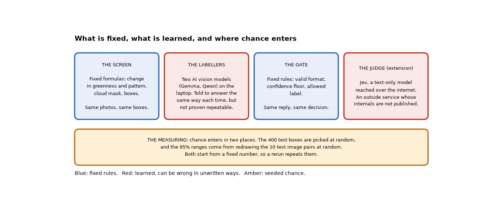
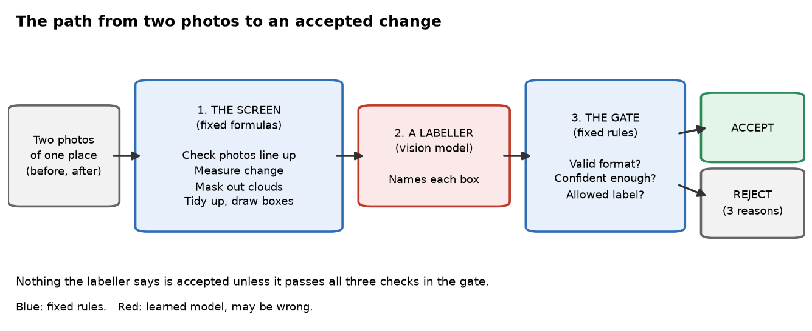
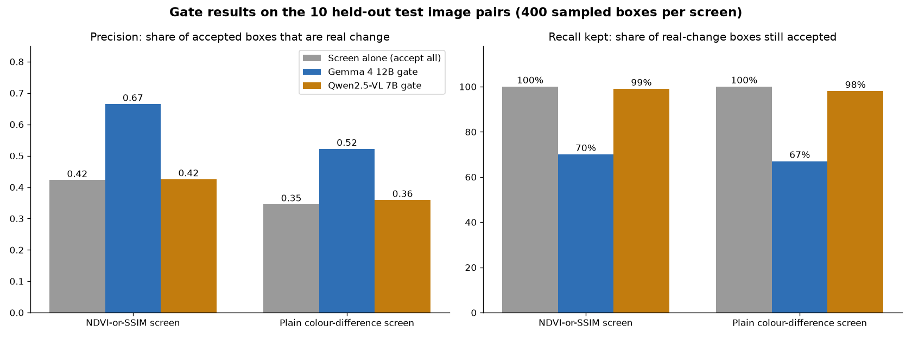
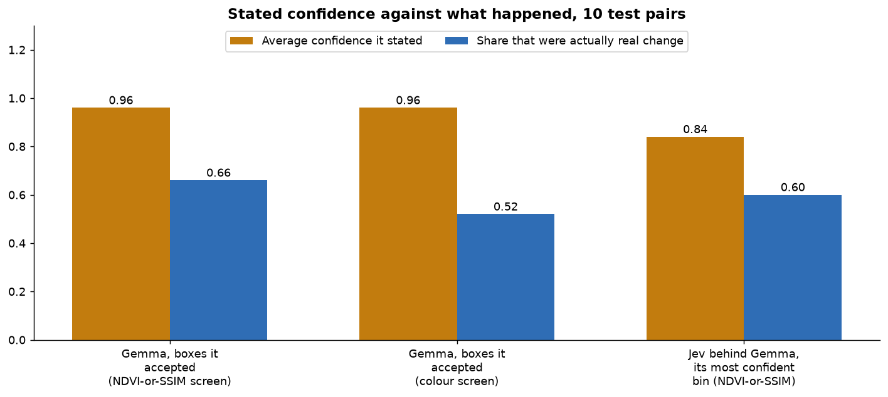

# geo-eval-gate

*A program that compares two satellite photos of the same place, proposes the spots that changed, lets an AI vision model name each change, and accepts a name only if it passes fixed checks. It comes with a measured study on real imagery.*

Status: version 0.2, a working research prototype, built between 9 and 13 October 2026. Code: https://github.com/PCSchmidt/geo-eval-gate (under the MIT (Massachusetts Institute of Technology) licence, a permissive open-source licence that lets anyone reuse the code). It is not deployed, and nothing shows that anyone but me has used it.

Take two satellite photos of one city taken a year apart. Subtracting one from the other should show what changed, but it lights up almost everywhere. Crops turn brown in autumn, clouds drift across, the sun sits at a different angle, and the few new roofs are buried in the noise. Sending every changed patch to an AI model that looks at pictures is slow, and the model makes confident mistakes, such as calling a cloud a building.

geo-eval-gate is built around one idea: the AI may propose, and plain code decides. A cheap first stage, called the screen, measures change with fixed formulas and draws boxes around the likeliest spots. A VLM (vision-language model), an AI model that reads a picture and answers in words, then labels each box from a short list: new structure, road, earthworks, seasonal change, or cloud. Its answer is treated as untrusted text. A final stage, called the gate, accepts a box only if the answer has the exact expected format, the model's stated confidence clears a floor, and the label is one that counts as real, human-made change.

The larger part of the project is a study of whether this design works on real imagery. It uses OSCD (Onera Satellite Change Detection), a public set of 24 pairs of city photos from Sentinel-2 (European Earth-observing satellites), with human-drawn outlines of new buildings and roads. A written plan came first, then tuning on 14 pairs, then one scoring run on the other 10. Each pixel covers 10 metres on the ground, so a house is only a few pixels.

Two measures carry the results, so here they are in plain words. Precision is the share of accepted boxes that really are change: if the program accepts 10 boxes and 6 are real, precision is 0.6. Recall is the share of the real changes that the program found. Accepting every box finds everything, so its recall is 100% and its precision is low. A gate is useful only if it raises precision without losing too much recall.

Here are the key results. About 42% of the sampled boxes were real change, so accepting everything gives a precision of 0.42. Behind one model, Google's Gemma 4 12B (a free, downloadable AI model; the 12B means 12 billion adjustable numbers), the gate raised precision to 0.67 while keeping 70% of the real changes. Behind a second free model, Alibaba's Qwen2.5-VL 7B (7 billion adjustable numbers), the gate added nothing. The confidence figures that both models state turned out to be unreliable as a control. And the screen is the weak stage: it finds only about 39% of the labelled changes, and nothing downstream can recover a change that never became a box. Everything rests on 10 test image pairs, so many comparisons cannot be told from luck, and the study says so.

Here is what is fixed and what is learned. A calculator is deterministic: the same input always gives the same answer. A weather forecast is probabilistic: it is a best guess that can be wrong. The screen and the gate are calculators. They contain no learned model, and the same photos and the same model reply always give the same boxes and the same decision. The labelling step is the forecast. The two vision models learned from examples, they can be wrong in ways nobody wrote down, and their stated confidence is not a true probability.

The models were told to answer the same way every time, but it has not been shown that a rerun gives identical replies. Chance enters the measuring in two places. First, 400 boxes were sampled for each test. Second, the study states a 95% range for some differences, meaning an interval that the true figure very likely falls in, found by redrawing the 10 test pairs at random many times. Both draws start from a fixed starting number (a seed), so a rerun repeats them. A repeatable program is not necessarily a correct one, and the results chapter shows where this one is wrong.



AI coding agents wrote almost all of the code. If you have ten minutes, read the chapters on what it does, the results, and the strengths and shortcomings.

## What problem this solves

Anyone who watches places from space has the same problem. Change detection means finding what is new between two dates: a new building, a widened road, a cleared field. Analysts need the short list of real changes, not a map speckled with seasons and clouds. The usual alternatives are reading the raw difference by eye, which is slow, or training a model to outline changed objects pixel by pixel, which needs a large set of hand-labelled examples and is hard to explain. Making the AI the decision-maker adds a different risk, because its confidence can be wrong without warning.

I built it because it fits my portfolio and my interests, and I chose satellite change detection for that reason. The README (the project's front-page description) says the project began as an item in a longer roadmap; I don't recall where the file for that item is. Asked whether anyone besides me is meant to use it, or has tried it, my answer was "probably not".

The people with this problem are analysts who study satellite imagery, and anyone building a pipeline that puts a vision model in front of an analyst. No user is shown beyond me. The README names four kinds of reader, and they are intended, not proven. Defense-related analysis is of interest to me, and this project fits it.

The goal has two parts. One is a design: a fixed stage narrows the field, and fixed rules decide what the model may approve. The other is evidence on whether the design works. Synthetic scenes (pictures the project generates itself) test the screen alone. The OSCD study tests the whole chain against human labels, with success criteria written down before any result existed.

The project deliberately does less than it could. It does not download imagery, outline objects precisely, run in near real time or cover other satellites. The README lists what the original roadmap named and the project did not build: two larger image models and download tools for several satellite-data services. The results say nothing about those.

A skeptic would ask, "Why not train a model on labelled change?" The project does not compare against that. It compares against simpler things: accepting every box, and a small statistical formula that scores each box from three numbers. A trained model could beat the whole design, and the project does not test that.

In short, the project asks whether a cheap screen followed by a rule-bound gate gives an analyst a better list than the screen alone, and it answers with measurements on a small real dataset.

## What it does, step by step

The input is two photos of the same place with four colour bands: red, green, blue and near-infrared (light just beyond red that healthy plants reflect strongly). The output is a list of boxes, each with a decision and a reason.



The best everyday comparison is a hospital triage desk with a specialist behind it. A nurse with a thermometer sends only the patients with fevers through (the screen). The specialist writes a diagnosis for each (the model). A clerk then checks the paperwork: is the form filled in correctly, did the specialist sound sure, is this one of the diagnoses that needs action (the gate). The comparison breaks down in one place. A clerk can ask the specialist to explain, while the gate can only read what is written.

The project ships a demo on a synthetic scene: two buildings, one cloud and an autumn decline in vegetation. The screen draws two boxes, one around each building, and none around the cloud or the autumn change. The demo then feeds the first box five hand-written replies standing in for a model. A reply naming a new structure with 0.93 confidence is accepted. A reply with confidence 0.55 is rejected, because it is under the 0.80 floor. A reply naming seasonal change is rejected as not actionable. A reply that is not valid JSON (JavaScript Object Notation, a plain-text format for structured answers) is rejected for its format, and so is one with a label that is not on the list. These are scripted strings, not model outputs.

A person does not appear anywhere in the chain. An analyst would read the accepted boxes and their recorded reasons, and the README presents that as the intended use. Using this in a government or regulated setting would need approved imagery sources, access control and a saved audit trail, and none of these exists here.

## The parts, the data and the tools

The program has five parts, each with one job. A loader reads the two photos and refuses a pair whose map position or size differ. The screen measures change, masks clouds and draws boxes. A runner sends each box, as a before-and-after picture, to a vision model and gets text back. The gate checks the text. Scoring helpers grade the results against human labels. A generator of synthetic scenes supports the tests.

Two rules are enforced in code. First, two photos that are not lined up are refused, not compared. Second, a model's reply is accepted only if it passes all three gate checks (format, confidence floor, label), so every outcome is one of four: accept, or reject for format, for low confidence or because the label is not actionable. Tests attack both rules.

The data are of two kinds. The synthetic scenes are made by the project: a 128 by 128 pixel vegetated patch with two rectangular buildings and one cloud added in, and a seasonal decline applied to the whole image. They are labelled by construction and carry no real-world meaning. The real data are OSCD, fetched on demand by a script from a Hugging Face copy (Hugging Face is a public website for sharing datasets and models) and never committed to the repository. The dataset lists no licence, so the project publishes only numbers derived from it and text the models wrote about it. Its labels cover urban change only. A real change in crops or water is unlabelled, so any such box the screen finds counts as a mistake, and every precision figure is therefore pessimistic.

The program is written in Python, with numerical libraries for the image maths. The vision models run through Ollama, a program that runs open AI models on one's own computer. Results are saved as plain files, with every model reply kept, so a result can be traced to its source. The slowest step is the model: about two seconds per box for Gemma and three and a half for Qwen, on a laptop GPU (graphics processing unit, the chip that runs AI models quickly), as the study documents record. An image pair produced 74 to 104 boxes on average, so labelling one pair takes roughly three to six minutes by simple arithmetic (about 74 boxes at 2.1 seconds is under three minutes; about 104 boxes at 3.6 seconds is over six).

## How the screen and the gate work

The screen starts by measuring two kinds of change at every pixel.

The first is NDVI (Normalized Difference Vegetation Index), a number that says how green a pixel is. It is the near-infrared reading minus the red reading, divided by their sum. Healthy plants reflect a lot of near-infrared and absorb red, so they score high. With made-up readings, a field might score 0.67 in summer and 0.52 in autumn, a drop of 0.15, while a new roof scores about 0.02, a drop of about 0.65. A cut-off of 0.25 ignores the autumn field and flags the roof.

The second is SSIM (Structural Similarity Index Measure), a score that compares the pattern of a small window of pixels in the two photos. It is 1 when the patterns match and lower when they do not. A field that turns brown keeps its texture, so the score stays high. A new building adds sharp edges, so it drops. The project uses 1 minus SSIM, so a bigger number means more structural change. A pixel counts as changed if either measure moves past its cut-off.

Two clean-up steps follow. The cloud mask removes pixels that are bright and nearly the same in red, green and blue, which is what white looks like, and it widens by six pixels so the halo around a cloud does not leak through. A leak of that kind was an early bug, found and fixed under tests. Then specks are erased, small gaps are filled, and any region below a minimum area is dropped. Each surviving region becomes a box.

The gate then examines each model reply in a fixed order. It first checks the format: valid JSON, a confidence between 0 and 1, one of five allowed labels, a reason of 10 to 600 characters, and no extra items. Next it compares the confidence with a floor, 0.80 by default. Last it checks that the label is one of three that count as action: earthworks, new structure, or road expansion. Seasonal change and cloud are real labels that the gate rejects by design. The order matters, because it decides which reason is recorded.

The scoring follows the plain definitions given earlier, with one worked case from the real study. Of 400 sampled test boxes, about 169 were real change, which is 42%. Gemma accepted 179 boxes and 119 of them were real, so precision was 119 of 179, or 0.665, and recall was 119 of 169, or 0.70. F1 (the harmonic mean of precision and recall) is a single score from 0 to 1 that is high only when both are high, and it is used for the screen itself.

NDVI and SSIM are standard methods. The project's own work is the way they are combined, the cloud margin and the gate. One choice is worth knowing: a box counts as real when at least 30% of its pixels fall inside a human-drawn change outline. A higher or lower setting was possible, and the study does not test other values.

## The models and what they do

Three models appear. Two label boxes in the main study, and one is an optional extension.

Gemma 4 12B is a vision-capable model from Google's Gemma family of freely downloadable models. Qwen2.5-VL 7B is a vision-language model from Alibaba's Qwen team. Both run through Ollama on a local laptop, with no internet use and no cost beyond electricity. I chose them because they are inexpensive and locally hosted, I think. The protocol adds that Gemma was already installed, and that Qwen would be used if it could be downloaded. The repository compares no other models. Real alternatives include other open vision models, a paid hosted model, or a model trained for this one task. Their licences were not checked.

Each model receives one picture, with the "before" crop on the left and the "after" crop on the right, plus the same fixed instruction. The instruction tells it that it is an imagery analyst, that pixels are about 10 metres so objects look coarse, and that it may call something a structure, road or earthworks only if human construction is visible after and absent before. It must treat colour changes in fields and trees as seasonal and bright white patches as cloud, and it must answer in the exact format. The runner asks for the same answer every time (no randomness, a seed of 0). A typical Gemma reply gave a confidence of 0.95, the label new structure, and one sentence such as "A new building or structure is visible in the upper right quadrant of the image that was not present in the before image."

What each model got wrong shows in the numbers. Of 400 test boxes, Gemma called 202 seasonal change, 167 new structure, 19 cloud, 7 earthworks and 5 road, so it rejected about half and accepted 179. Qwen called 395 of 400 either new structure or road expansion, so it accepted nearly everything. Gemma stated only three confidences, 0.90, 0.95 and 1.00, and 88% of its answers on tuning data were exactly 0.95. A floor anywhere up to 0.95 therefore lets through the same boxes, so the floor has no effect and the label does all the work.

Gemma is a "thinking" model that first reasons silently. With a short cap on reply length it spent everything thinking and returned an empty answer every time at first. The runner now turns that phase off, and then every reply was valid. How it behaves with thinking on is untested.

The prompts are kept in the repository like code, were fixed before any data were seen, and were not tuned, so Qwen's weak result may be a prompt effect. Tests use a fake local server to check that the request carries the image and the format rules, and that a reply flows through the gate. The models' real behaviour is measured only in the study. Models are pinned only by their Ollama name, with no checksum recorded, so a re-uploaded model could change the results.

The third model is Jev, from a company called TypeSafe. The project does not say what the name stands for. It is a text-only model reached over the internet that answers yes or no, as a probability its makers call calibrated: when it says 80%, it should be right about 80% of the time. I was drawn to it by a novel idea I wanted to test and learn more about. The main study had found the vision models' confidence unreliable, and the extension asks whether Jev, placed behind Gemma, could supply a number worth putting the floor on.

Jev cannot see images. It receives a short text with a box's size and its NDVI and SSIM change, and in one version Gemma's reply too, and it answers one fixed question: is this a genuine human-made building or road, rather than seasonal change, cloud, shadow or noise? The whole experiment cost about six cents per the documents, which cannot be checked against an invoice here, and who paid for it is not answered. The vendor's terms forbid using its output to train another model. The vendor's claims about its calibration are not confirmed by anything here. The same service is used in my VERA project.

Is the whole model layer needed? A simple baseline suggests it adds something only when the model is good: a logistic regression (a small statistical formula that turns a few numbers into a probability) that sees only each box's area and two change values ranks real boxes nearly as well. Gemma ranks slightly better, and Qwen ranks worse than the three numbers.

The only human control is outside the program: a person would read the accepted boxes. Nothing stops the models from being wrong, but nothing they say is accepted without three fixed checks, and a missing confidence or label is refused by design.

In short, Gemma gave the gate something to work with, Qwen did not, and Jev behind Gemma gave a better-behaved number but no better judgment.

## Edge cases, tests and safeguards

The test suite has 54 tests, and in a scratch copy outside the repository they all pass. A first run without git history skipped three tests of the secret-leak guard, which need it; all 54 passed inside a git copy. A type checker (a tool that reads code for mismatched kinds of data) passes too. Some tests generate many random inputs and check that a rule always holds; one feeds random text to the gate and checks that nothing is accepted without a valid confidence. A fake local server stands in for the model services. Other tests check that a seasonal change alone produces no boxes, that clouds are masked and that boxes stay inside the image. The scripts that produce the study results have no tests of their own, and the real-data study was not re-run, since it needs a large download and a GPU.

Some tests are weaker than they sound. The random-text test almost never produces valid JSON, so it rarely reaches the accept path. The gate has a better test with ten named cases.

Small bad inputs were tried against the rules in a scratch copy. The outcomes were these.

| Situation | What happens | Handled well? |
| --- | --- | --- |
| Two photos of different size | Refused with a clear error | Yes |
| Reply is not JSON, or is empty | Rejected for format | Yes |
| Confidence 1.5, or NaN (not a number) | Rejected for format | Yes |
| Extra item, short reason, or lowercase label | Rejected for format | Yes |
| Label is cloud, confidence 1.0 | Rejected as not actionable | Yes |
| Confidence exactly 0.80 | Accepted, since the floor is "at least" | Yes |
| Reply wrapped in a code block | Rejected for format | Strict, but safe |
| Confidence written as text "0.95" or as true | Accepted, and read as 0.95 or 1.0 | Weak: the format is not as exact as it sounds |
| A photo full of missing values | Zero boxes, no error | Weak: silent |
| A perfectly flat scene | Zero boxes | Yes |

The program holds no state between runs, so a crash halfway leaves nothing half-done. The study scripts cache every model reply and resume, and an earlier tuning run crashed when the laptop's GPU reached 93 degrees Celsius and slowed from 1.4 to 6.6 seconds per call. The runner now retries, pauses to cool and stops on the first failure. A hostile reply cannot do more than have its text recorded, since nothing acts on the reason.

Automatic checks run on every change on GitHub, a code-hosting site. They install the package, run the type checker and run the tests. They do not run the style check the README implies, and they cannot fail because quality on real data dropped.

The study was run plan-first. The plan was committed on 10 October at 10:28, and the first real-data results about an hour later. Settings were frozen and committed on 11 October at 07:34, before the one test run at 08:56. The plan states what would count as failure, and deviations are listed one by one. The commit times match the start times of GitHub's automatic runs for those pushes, but nothing shows the test images were unseen before the plan was written. The Jev extension's own plan says openly that the test split had already been seen.

In short, the gate's rules held up against the cases tried, though messy real input, such as missing values, is the weaker side.

## Does it work? The results

The short version has three parts. The screen is weak. The gate raised precision behind Gemma and did nothing behind Qwen. And the stated confidence could not be trusted as a control.

**The screen.** On the 10 test pairs the main screen scored a pixel F1 of 0.33, and a plain colour-difference baseline scored 0.35. The two are equal in practice, and both find only about 39% of the 668 labelled change objects. The cloud mask changed nothing on this real data. On synthetic scenes the screen does as designed: in 100 scenes it found 0.975 of the buildings with no false boxes, while a version without the cloud mask found all of them but drew 0.61 false boxes per scene. These scenes are idealised, so they show the mechanism and not real-world performance.

**The gate.** Here is the chart for the 10 held-out pairs (pairs kept aside during tuning and scored once).



Behind Gemma the gate raised precision from 0.42 to 0.67 on the main screen and from 0.35 to 0.52 on the baseline screen, keeping 70% and 67% of the real changes. For the first, the 95% range of the gain is 0.09 to 0.33, which excludes zero. Behind Qwen, precision barely moved and nearly all boxes were accepted. Gemma's edge over the three-number formula in ranking boxes is within the range of chance, so it is not established.

**Confidence.** A well-calibrated model that says 90% should be right about 90% of the time. Both models fell far short of that. On the main screen Gemma stated about 96% confidence on the 179 boxes it accepted, and 66% were real.



The Jev extension ran on the same test data. Behind Gemma it gave the same precision lift and recall as Gemma's own gate, with a threshold one can move. Its calibration gap was 0.17 and 0.12, better than Gemma's 0.23 and 0.28 once converted, and still short of the 0.10 bar the plan set. A logistic regression on the same inputs plus Gemma's reply matched or beat Jev on ranking. Jev reading only the bare numbers did poorly. The results describe Jev as a calibration layer that behaved better than Gemma's own figure, and not a better judge.

For the curious, the ranking comparisons use AUROC (Area Under the Receiver Operating Characteristic curve), the chance that a randomly chosen real box scores above a randomly chosen unreal one, where 0.5 is a coin flip: Gemma 0.73, the three-number formula 0.66, Qwen 0.58. The calibration gap is the ECE (Expected Calibration Error), the average distance between stated confidence and how often the model was right; both vision models scored 0.29 to 0.47 against the plan's acceptable limit of 0.2.

What did not work is clear: Qwen, confidence as a control, the planned screen beating the plain baseline, and any gain that survives the small sample. The documents report all of it, together with the plan's failure criteria.

Several limits apply to all of it. The test set is 10 pairs. Gate figures cover a seeded sample of 400 boxes per screen. The settings tuned on development data sit at the edge of the grids searched. The pair-level ranges were added after the test results had been seen, because boxes inside one pair are alike. The Jev test reused a split already seen. The key numbers match the committed result files, but the real-data runs were not repeated.

Three things follow. The design raised precision when the model was good enough and did nothing when it was not. The confidence floor, as built, is not a control. And the screen limits everything: by simple multiplication, roughly a quarter of the real objects would survive both stages, an estimate and not a measurement.

## Could it be put into real use?

It has never run outside a laptop and GitHub's test service. It is not deployed and no user is shown. On a ladder of four rungs (an experiment, something that works locally, something deployable, something operated), it sits on the second. It runs, passes its own tests and has been measured, but it has no hosting, monitoring or users.

Someone else can install and run it from the quickstart. A Docker file (a recipe for packaging the program) and a README command run the tests with the network switched off, though that was not run here. The model step has retries and a cool-down. The program writes no log to diagnose a failure afterwards, other than the saved model replies. No secrets are committed, a test guards against that, and a scan of current files and history found none. Package versions are not pinned, so a fresh install gets newer libraries than the study used, and the synthetic benchmark still reproduced in a scratch copy.

To become deployable it would need a service wrapper and hosting, a saved log of each decision, pinned versions, a quality check in the automatic runs, a rollback plan and a licence review of the data. Reusable pieces are the gate, which any project that takes text from a model could adapt, and the plan-then-results documents, but it is not a drop-in package. As a showcase for taking something to production it is possible but not strong: the gate is meaningful, but the evidence is thin and the screen is weak.

## Strengths, shortcomings and the work still to do

The study design is the part most worth examining. The plan names its own failure tests in advance, the held-out pairs are scored once, deviations are listed in order, and a negative result is reported as one. The Jev plan wrote down its expectations in advance, and the results record that one was wrong, one was right and one was unsure and then failed. Only commit times and the matching automatic-run times back this up. One caution: the plan and results documents speak in the first person ("I expect Jev to be well calibrated"). By my answer, the agents drafted those statements and I approved or edited them, so the repository's first-person wording differs from how they were written.

The shortcomings fall into three themes.

The first is the screen. It finds about 39% of what humans labelled, and the planned design was no better than a plain colour difference. The next step the evidence points to is a stronger screen, since the gate cannot recover missed changes. It is a larger effort with a high payoff, and the README's roadmap lists it as unbuilt.

The second is the confidence floor. It does no work with the models tested, and the input check is looser than it looks (a text "0.95" is accepted). The options are to drop the floor from the claims or to put a calibrated layer behind it, as the Jev extension explored, and to tighten the format check. These are small to medium fixes.

The third is that the documents lag the code. The README says it has no real model runner yet, though one exists, and it lists a calibrated judge as not done, though the extension is built. I want those two lines corrected in the repository; that has not been done. The package lists optional dependencies that no code uses. All are cheap to fix.

Promised against built: the screen, the gate, the loader, the scoring, the local runner and the two studies are built and tested. The roadmap's larger models and download tools are not built, and the README says so. Running costs nothing for the local models and about six cents for Jev. The full study needs a GPU, a large dataset download and a few hours of model calls. Asked whether the project is finished, my answer was that it probably still needs some work and improvements. Time is not an issue, and my goal is the best project it can be. I have not yet chosen which backlog items to do.

## How it was built, and who did what

AI coding agents wrote almost all of the code, the tests, the study scripts and the first drafts of the documents. The commits carry co-author credits for two AI assistant models, and all are under my name. Asked whether that is the full picture of which AI tool built it, I answered "yes, I think so". The repository contains no agent instruction files.

The documents record these decisions: to test the design on real labelled imagery, to write the plan and failure criteria before any result, to add a plain colour screen after the development results, to score the held-out pairs once, to test the Jev calibrated judge after the confidence result, to keep the test split's reuse in the open, and to publish the weak results. By my answer, the choices on real imagery, the failure criteria, the plain screen and the Jev extension were agent suggestions that I approved or adapted. As noted above, the agents also drafted the first-person statements in the plan and results documents, and I approved or edited them. I overrode or caught an agent sometimes, and I do not remember a specific case. The history shows a few agent mistakes: the cloud-halo bug and an ordering bug in the scene generator were fixed while writing the first tests, and a secret-guard test falsely flagged a test string, so the automatic run on that commit failed before a fix. Five days of work landed in a few large commits, so the history says little more. I do not recall whether I ran the real-data study myself on my laptop, or how long the full runs took, and the repository does not record it.

On understanding, I need to refresh my memory of NDVI, SSIM, calibration and the bootstrap. I do not recall what surprised me in the results, and I am unsure what was hardest. An earlier explainer sat in the repository; it was meant to be replaced or updated by this one, and the history shows it was replaced when the plain-language version was published on 27 October 2026.

## For recruiters and interviewers

**In thirty seconds.** AI coding agents built a small satellite change-detection pipeline, with my approval of their suggestions, in which a vision model may suggest a label, and fixed code decides whether to accept it. It was then tested on real imagery with a plan written first. With one model the gate improved precision by about 0.24, with another it did nothing, and the models' stated confidence was unreliable. **In two minutes**, add the weak screen, the small test set, the calibrated-judge follow-up and that nobody else has used it.

**What it shows.** Measurement and plain reporting of weak results, a gate between a model and an action, and working with AI coding agents toward a result that can be defended. It does not show that I can train a model, operate a service, work on a team or write the code by hand. The nearest role family is the applied AI engineer, who builds workflows from existing models with checks around them. It is a weak fit for other roles, since nothing is deployed or trained.

| What a role usually wants | What this project shows | How strong |
| --- | --- | --- |
| Evaluating AI output against a goal and a baseline | Held-out pairs, baselines, ranges, failure criteria | Reasonable evidence, on 10 pairs |
| Controls around a model (format, confidence, rules) | A gate, with tests and measured results | Format and label checks worked; the confidence control failed |
| Choosing between models | Two models compared, one text judge | Partly, on one prompt and 10 pairs |
| A person reviewing AI output | None; reasons are recorded | Not shown |
| Deploying and operating | Local only | Not shown |

Five tough questions. *Isn't this a wrapper around a model?* Partly: the models are borrowed, while the screen, the gate and the study are the project's. *If agents wrote it, what did you do?* Approved or adapted the agents' suggestions for the plan, the failure tests and the extension, and sometimes overrode or caught an agent. *Why believe the numbers?* They match the saved files and the plan came first, but it is one author, 10 pairs and no repeat. *Have you run it for users?* No. *What if the model output is malicious?* The gate refuses anything that is not the exact format, and nothing acts on the reason text.

A five-minute demo would run the example script and show the five gate decisions, show the gate chart, and open the plan next to the results. Do not overstate: the gain is on 10 pairs, one model helped, the screen is weak, and nothing is deployed.

## Glossary

- **Change detection:** finding what is new between two photos of the same place.
- **Screen:** the fixed first stage that proposes boxes where something changed.
- **Gate:** the fixed rules that decide whether a model's label is accepted.
- **Precision, recall, F1:** the share of accepted boxes that are real; the share of real changes found; and one score that is high only when both are.
- **Held-out:** data kept aside, never used for tuning, and scored once.
- **Baseline:** a simple method used as a yardstick.
- **Seed:** a fixed starting number that makes a random process repeat.
- **95% range:** an interval the true figure very likely falls in.
- **Calibrated:** saying 80% and being right about 80% of the time.
- **VLM, NDVI, SSIM, JSON, AUROC, ECE:** defined where they first appear above.
- **Jev:** a text-only model from the company TypeSafe, used in the extension; the project does not say what the name stands for.

## Where to look in the code

This list is for engineers; other readers can stop here.

```
geo-eval-gate/
  src/geo_eval_gate/  screening.py (the screen), gate.py (the gate), vlm_ollama.py (model runner),
                      jev.py (Jev client), scoring.py (metrics), synthetic.py, oscd.py, candidate_set.py
  tests/              54 tests, including fake-server tests
  scripts/            the real-data study scripts and the synthetic benchmark
  docs/               PROTOCOL*.md (plans written first), RESULTS*.md
  results/real/       frozen settings, every model reply, all result files
  examples/demo.py    the five-decision demo
```

Install with pip in a fresh environment, then run the tests and the demo; both worked in a scratch copy. Read first: gate.py, screening.py, docs/PROTOCOL.md, docs/RESULTS_REAL.md and docs/RESULTS_JEV.md.
